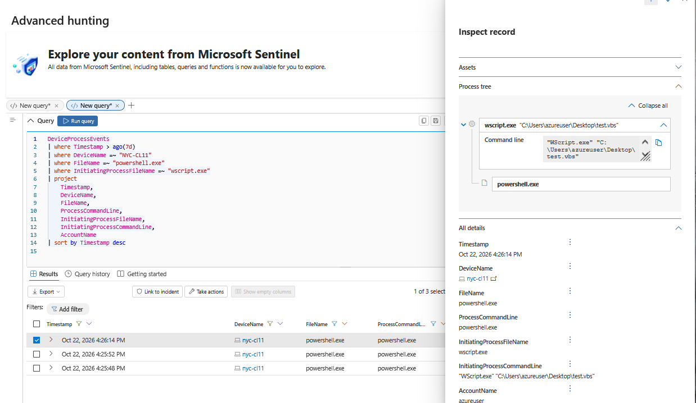

# Suspicious PowerShell Execution

## Objective
Investigate PowerShell processes spawned by Windows scripting engines using Microsoft Defender XDR and Microsoft Sentinel.

## Hypothesis
PowerShell execution initiated by `wscript.exe` or `cscript.exe` may indicate suspicious script-based activity requiring further investigation.

## Lab Environment
- Windows 11 virtual machine
- Microsoft Defender for Endpoint
- Microsoft Defender XDR Advanced Hunting
- Microsoft Sentinel

## Investigation Status
**Initial Investigation Complete**

## Investigation Plan
1. Identify PowerShell execution events.
2. Analyze parent-child process relationships.
3. Examine command-line arguments.
4. Correlate related Defender alerts and network activity.
5. Evaluate findings and potential false positives.

## Findings

### 1. Suspicious Process Execution

Using Microsoft Defender XDR Advanced Hunting, three process creation events were identified on the Windows 11 lab endpoint `NYC-CL11`.

- **Parent process:** `wscript.exe`
- **Child process:** `powershell.exe`
- **Initiating script:** `C:\Users\azureuser\Desktop\test.vbs`
- **Observed events:** 3
- **Date:** October 22, 2026

Process-tree analysis confirmed that Windows Script Host initiated PowerShell. The observed child command line was `powershell.exe`, without additional arguments.

The activity was intentionally generated as part of a controlled lab simulation.

### 2. Network Activity Investigation

To investigate potential outbound communications, `DeviceNetworkEvents` was correlated with the identified PowerShell processes using device identifiers, process IDs, and process creation timestamps.

**Results:**

- 1,060 network events were recorded on the lab endpoint during the seven-day query window.
- No network events matched the three PowerShell processes launched by `wscript.exe`.
- Two other PowerShell-initiated network connections were identified.

Further process analysis showed:

| Process ID | Parent Process | Initial Assessment |
|---|---|---|
| 8688 | `senseir.exe` | Consistent with potential Defender-related activity |
| 8808 | `windowsterminal.exe` | Consistent with interactive PowerShell activity |

Both connections used TCP port 443 and were recorded as successful.

These connections were associated with different PowerShell process instances from those involved in the original script execution.

### 3. Investigation Conclusion

**Disposition: Benign — Controlled Lab Simulation**

The investigation confirmed that a Windows scripting engine launched PowerShell on three occasions.

No network connections were identified for those specific processes in the available telemetry.

The observed behavior matched the intentionally generated lab activity. No malicious behavior was established.

This investigation demonstrates that suspicious process ancestry is an investigative lead, not proof of compromise.

## Hunting Query

The reusable KQL hunting query is available in [hunting-query.kql](hunting-query.kql).

The query identifies PowerShell processes initiated by Windows Script Host across onboarded endpoints.
## Investigation Evidence

### Process Tree Analysis

Microsoft Defender XDR Advanced Hunting identified three PowerShell execution events on October 22, 2026.

The process tree confirms that `wscript.exe` launched `powershell.exe` through the controlled `test.vbs` script.

## Lessons Learned

- **Process ancestry:** Parent-child relationships provide valuable context for identifying potentially suspicious execution.
- **KQL correlation:** Combining process identifiers and creation timestamps helps associate network activity with specific process instances.
- **Telemetry validation:** Confirming that network telemetry exists is important before interpreting empty query results.
- **False positives:** Legitimate administrative tools and controlled scripts may generate behavior that resembles malicious activity.
- **Investigation methodology:** Detection results must be contextualized before determining whether activity is malicious.

## Limitations

- Results reflect the available Defender telemetry and queried retention window.
- Absence of matching network events does not prove that network communication was impossible.
- The hunt identifies a specific execution pattern and does not detect every form of malicious PowerShell activity.
- The generalized hunting query should be validated and tuned before use as a production detection.
- Defender alert correlation was not fully documented in this investigation and remains an area for further validation.

## Future Improvements

- Add additional suspicious PowerShell parent processes.
- Investigate encoded commands and potentially suspicious execution arguments.
- Incorporate relevant MITRE ATT&CK technique mappings.
- Evaluate false positives against a larger endpoint dataset.
- Develop and test a Sentinel analytics rule based on validated detection logic.
