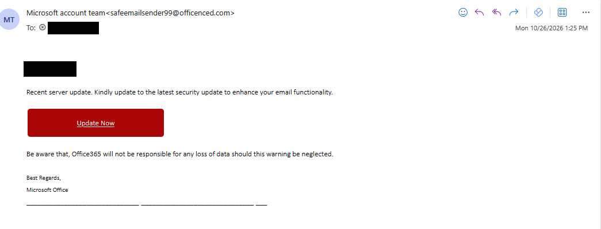
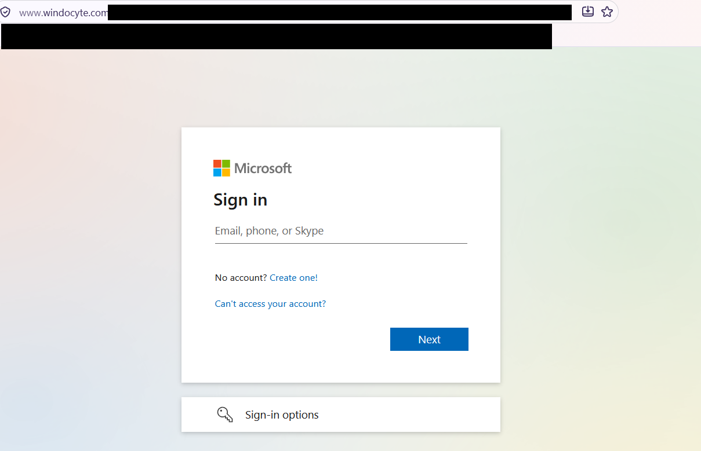
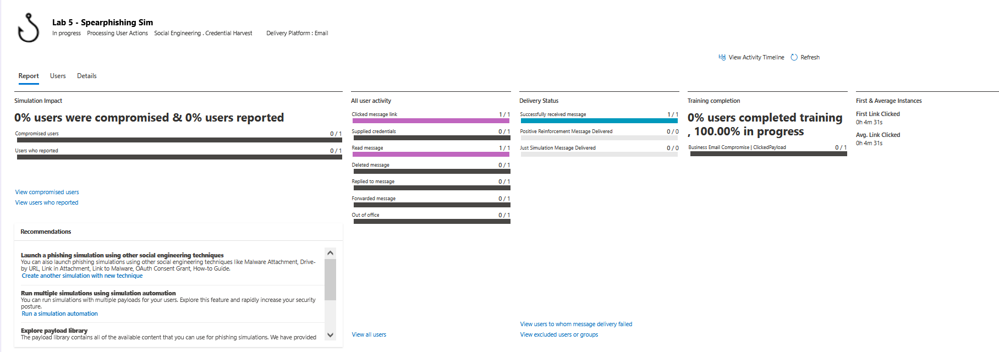
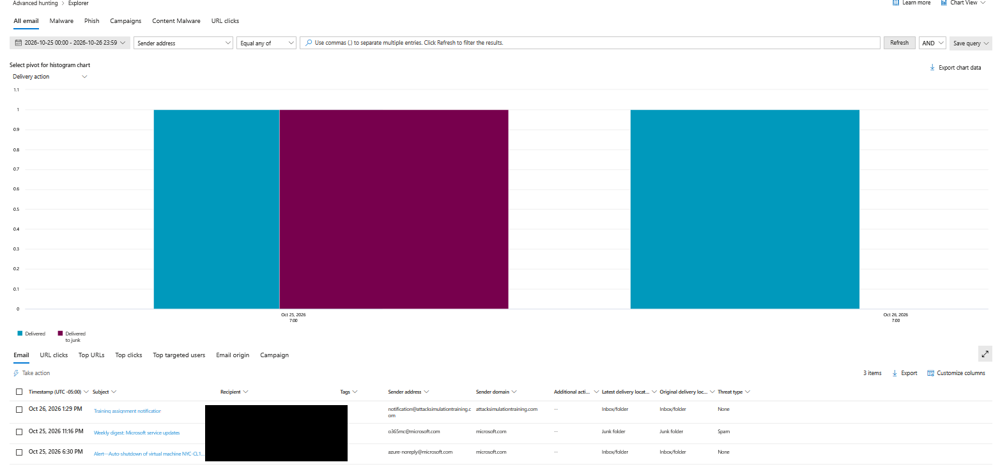
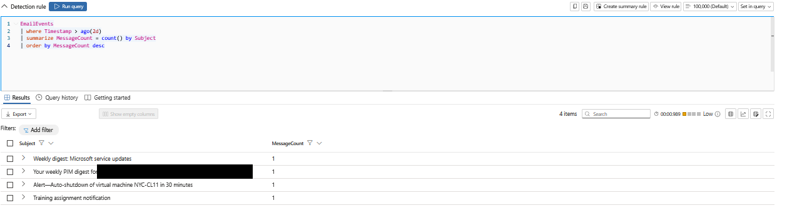
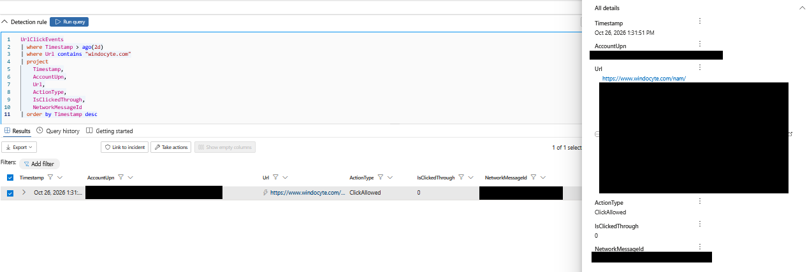
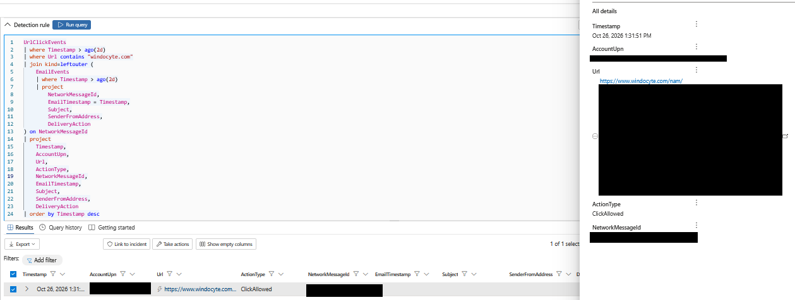

# Credential Harvesting Simulation — Microsoft Defender for Office 365

## Overview

This lab documents an authorized credential-harvesting
phishing simulation conducted using Microsoft Defender
for Office 365 Attack Simulation Training.

The investigation examines phishing indicators, simulated
user interaction, and cross-portal telemetry visibility
using Microsoft Defender XDR and Kusto Query Language (KQL).

## Investigation Status

Completed — documentation in progress.

## Lab Environment

- **Platform:** Microsoft Defender for Office 365
- **Simulation tool:** Attack Simulation Training
- **Investigation platform:** Microsoft Defender XDR
- **Email client:** Outlook
- **Query language:** Kusto Query Language (KQL)
- **Scope:** Single-user Microsoft 365 test tenant
- **Simulation date:** October 26, 2026
- **Attack technique:** Credential Harvest
- **Payload:** Update your Office 365 Security

## Investigation Objectives

1. Execute an authorized credential-harvesting phishing simulation against a designated lab account.
2. Identify phishing indicators in the email and simulated Microsoft sign-in page.
3. Validate message delivery, user interaction, and credential-submission status using Attack Simulation Training reports.
4. Investigate email and URL-click telemetry using Defender Explorer and Advanced Hunting.
5. Correlate `UrlClickEvents` with `EmailEvents` using `NetworkMessageId`.
6. Document observed telemetry differences, investigation limitations, and defensive lessons.

## Simulation Methodology

### 1. Simulation Configuration

A controlled phishing simulation was configured in Microsoft Defender for Office 365 Attack Simulation Training with the following settings:

- **Simulation name:** Lab 5 - Spearphishing Sim
- **Attack technique:** Credential Harvest
- **Delivery platform:** Email
- **Payload:** Update your Office 365 Security
- **Target scope:** Single-user lab tenant
- **Simulation launch:** October 26, 2026
- **Scheduled end:** October 28, 2026
- **User training:** Assigned through Attack Simulation Training

### 2. Phishing Email Examination

The simulation delivered an email with the subject **Warning: Verify your email address**, impersonating the Microsoft account team.

Observed indicators included:

- A sender domain that did not match Microsoft's legitimate authentication domains.
- An urgent request to update account security.
- Language suggesting potential data loss if the recipient ignored the message.
- An **Update Now** button directing the recipient to a simulated sign-in page.

### 3. Controlled User Interaction

The designated lab user opened the message and followed the embedded link. The destination displayed a Microsoft-branded sign-in interface hosted on a non-Microsoft authentication domain.

No real credentials were entered or submitted. The simulation report subsequently recorded the message as delivered, read, and clicked, with zero credential submissions.

All activity was performed within an authorized lab environment. The simulation was not a real-world compromise.

## Investigation Findings

### 1. Attack Simulation Training Results

Microsoft Defender for Office 365 Attack Simulation Training
confirmed the following activity:

| Metric | Result |
|---|---|
| Messages delivered | 1/1 |
| Messages read | 1/1 |
| Phishing links clicked | 1/1 |
| Credentials submitted | 0/1 |
| Users compromised | 0/1 |
| Users who reported the message | 0/1 |

The simulation confirmed that the designated user interacted
with the phishing link without submitting credentials.
A link click alone was not evidence of credential compromise.

### 2. Defender Explorer Investigation

The simulated phishing message was not returned by a
subject-based search in Defender Explorer.

Removing the subject filter revealed other tenant email
activity, including a Microsoft Attack Simulation Training
assignment notification.

This established that Explorer contained email telemetry for
the investigation period, but the simulated phishing payload
was not visible in the results reviewed.

### 3. Advanced Hunting — EmailEvents

A search of `EmailEvents` for the simulated message subject
returned no matching records.

A broader query grouping email events by subject returned
four other messages, including the training assignment
notification.

This supported the observation that standard email telemetry
was available, while the simulated phishing payload was not
found using the queries performed.

### 4. Advanced Hunting — UrlClickEvents

A search of `UrlClickEvents` identified the simulated phishing
link interaction.

| Field | Observed value |
|---|---|
| Event timestamp | October 26, 2026, 1:31:51 PM |
| ActionType | `ClickAllowed` |
| IsClickedThrough | `0` |
| Total matching clicks | 1 |
| Unique users | 1 |
| NetworkMessageId | Present |

`ClickAllowed` indicated that the recorded URL interaction
was allowed.

`IsClickedThrough = 0` did not negate the click; it indicated
that the event was not recorded as a user clicking through
a warning or block page.

### 5. Cross-Table Correlation

A `leftouter` join between `UrlClickEvents` and `EmailEvents`
on `NetworkMessageId` retained the URL-click record but
returned no matching email fields.

The investigation therefore confirmed URL-click telemetry
without locating a corresponding email record in the
queried `EmailEvents` data.

### 6. Key Finding and Limitations

**Key finding:** Attack Simulation Training recorded delivery
and user interaction, while Defender XDR Advanced Hunting
independently recorded the allowed URL click.

However, the simulated phishing payload was not found in
Defender Explorer or `EmailEvents` during this investigation.

This represents an observed telemetry visibility discrepancy
within the lab, not proof that Microsoft Defender universally
excludes attack simulation messages from email telemetry.

The investigation was limited to one authorized simulation,
one test account, the available tenant telemetry, and the
query time windows used.

## Detection Opportunities

### 1. Correlate URL Clicks with Email Telemetry

SOC analysts can correlate `UrlClickEvents` with `EmailEvents`
using `NetworkMessageId` to investigate potentially malicious
links and their originating messages.

A `leftouter` join preserves URL-click activity even when
corresponding email telemetry is unavailable.

Unmatched records should prompt additional investigation
rather than an assumption of compromise or a product failure.

### 2. Investigate Suspicious Authentication Destinations

Phishing investigations should examine URLs that imitate
legitimate identity providers, particularly Microsoft-branded
sign-in pages hosted outside expected authentication domains.

Domain reputation, URL structure, message context, user
interaction, and available identity telemetry should be
considered together.

An unfamiliar domain alone is not sufficient evidence
of malicious activity.

### 3. Correlate Phishing Clicks with Identity Activity

Following a suspicious URL click, analysts should review
available Microsoft Entra sign-in logs for unusual authentication
activity, including unfamiliar locations, devices, failed
sign-ins, and risk detections.

In this lab, no credentials were submitted. No subsequent
identity compromise was established by the simulation evidence.

## MITRE ATT&CK Mapping

| Technique | ID | Relevance |
|---|---|---|
| Phishing: Spearphishing Link | T1566.002 | The simulated email contained a link directing the recipient to a credential-harvesting page. |

**Scope note:** The simulation demonstrated phishing-link
delivery and interaction, not credential theft, token theft,
or unauthorized access.

## Lessons Learned

1. **Validate telemetry across multiple sources.**
   Attack Simulation Training, Defender Explorer, and Advanced
   Hunting may provide different perspectives on the same
   simulated activity.

2. **Do not equate a click with compromise.**
   The simulation recorded a successful click without
   credential submission.

3. **Preserve unmatched records during correlation.**
   A `leftouter` join can retain useful evidence that an
   `inner` join would discard.

4. **Document visibility limitations precisely.**
   Missing records within a particular query window do not
   establish a universal product limitation.

5. **Maintain reproducible investigation artifacts.**
   KQL queries, screenshots, timestamps, and documented
   assumptions support repeatable analysis.

## Conclusion

This authorized Microsoft Defender for Office 365
credential-harvesting simulation demonstrated phishing-email
analysis, user-interaction validation, KQL-based threat
hunting, and cross-table telemetry correlation.

The primary investigative finding was a recorded phishing
URL click without a corresponding email record in the queried
`EmailEvents` dataset. No credential compromise was observed.

The exercise reinforced the importance of evidence-based
conclusions, cross-source validation, and transparent
documentation of investigation limitations.

No actual credential compromise was observed or demonstrated.
