# Operation False Foothold
### Lab 6 — Multi-Stage Attack Emulation & Detection Engineering

> **Authorized Security Simulation**
>
> This lab documents controlled endpoint activity performed
> in an isolated Windows 11 Azure VM. No actual malware,
> credential theft, or unauthorized access was involved.

## Overview

Operation False Foothold is a multi-stage endpoint security lab
designed to simulate suspicious workstation behavior and investigate
the resulting telemetry using Microsoft Defender XDR.

The exercise covers PowerShell execution, system discovery,
scheduled-task execution, outbound HTTPS communication,
custom detection engineering, and incident response.

A custom Microsoft Defender XDR detection successfully generated
a Low-severity alert and **Incident #782**, which was investigated
and resolved as expected security-testing activity.

## Lab Environment

| Component | Technology |
|---|---|
| Endpoint | Windows 11 Azure VM |
| Endpoint Security | Microsoft Defender for Endpoint |
| Investigation Platform | Microsoft Defender XDR |
| SIEM | Microsoft Sentinel (workspace available) |
| Query Language | Kusto Query Language (KQL) |
| Framework | MITRE ATT&CK |
| Lab Date | October 26, 2026 |

---

## Stage 1 — Endpoint Validation

### Objective

Verify that the Windows 11 Azure VM was successfully onboarded
to Microsoft Defender for Endpoint and generating endpoint telemetry
before beginning the attack simulation.

### Validation Procedure

1. Navigated to Microsoft Defender XDR.
2. Opened **Assets → Devices**.
3. Located the Windows 11 endpoint `nyc-cl11`.
4. Confirmed that the Defender sensor was reporting as **Active**.
5. Executed `whoami` and `hostname` from PowerShell to generate
   benign process activity.

### KQL — Process Telemetry Validation
```kql
DeviceProcessEvents
| where Timestamp > ago(24h)
| where DeviceName =~ "nyc-cl11"
| where FileName in~ ("whoami.exe", "hostname.exe")
| project
    Timestamp,
    DeviceName,
    FileName,
    ProcessCommandLine,
    InitiatingProcessFileName,
    AccountName
| order by Timestamp desc
```
### Results

Microsoft Defender successfully recorded process execution
telemetry from `nyc-cl11`.

- **Sensor health:** Active
- **Process events:** 225 events observed during the initial
  24-hour validation window
- **Validated processes:** `whoami.exe` and `hostname.exe`
- **Parent process:** `powershell.exe`

These findings confirmed that the endpoint was producing the
telemetry required for subsequent hunting and detection exercises.

**MITRE ATT&CK:** Not applicable to onboarding validation.
The commands were used to verify telemetry collection, not
to establish malicious discovery activity.

### Evidence


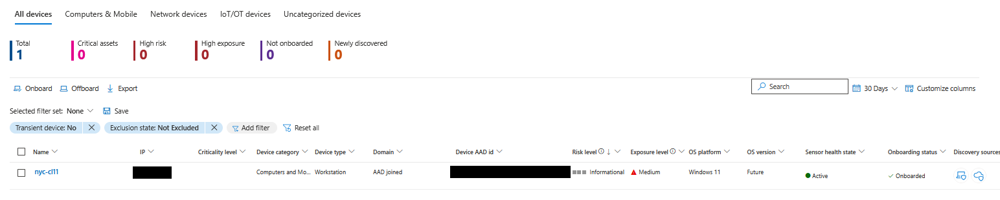

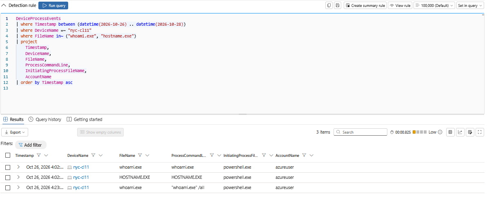


---

## Stage 2 — Initial PowerShell Execution

### Objective

Simulate the execution of a PowerShell script on the Windows 11 endpoint and determine whether Microsoft Defender for Endpoint captures the associated process activity.

This stage establishes a baseline for investigating script execution and parent-child process relationships.

### Execution Procedure

A benign PowerShell script named `Stage1.ps1` was created in the following directory:

`C:\AzureTrenches\Lab6\Stage1.ps1`

The script contained:

```powershell
Write-Output "OPERATION FALSE FOOTHOLD - STAGE 1"
Write-Output "Simulated initial execution"
Write-Output "Timestamp: $(Get-Date -Format o)"
Write-Output "Computer: $env:COMPUTERNAME"
```

The script was executed using:

```powershell
powershell.exe -NoProfile -File "C:\AzureTrenches\Lab6\Stage1.ps1"
```

The command completed successfully and displayed the expected lab identifier, timestamp, and computer name.

### KQL — PowerShell Execution Investigation

Microsoft Defender XDR Advanced Hunting was used to identify the process execution:

```kql
DeviceProcessEvents
| where Timestamp > ago(24h)
| where DeviceName =~ "nyc-cl11"
| where FileName =~ "powershell.exe"
| where ProcessCommandLine contains "Stage1.ps1"
| project
    Timestamp,
    DeviceName,
    AccountName,
    FileName,
    ProcessCommandLine,
    InitiatingProcessFileName
| order by Timestamp desc
```

### Results

Microsoft Defender successfully recorded the PowerShell process execution.

| Field | Observed Value |
|---|---|
| Device | `nyc-cl11` |
| Process | `powershell.exe` |
| Parent process | `powershell.exe` |
| Account | `azureuser` |
| Executed script | `Stage1.ps1` |
| Execution date | October 26, 2026 |

The telemetry demonstrated that Defender could identify the executed PowerShell process, its command-line arguments, and its initiating process.

The initial hunting attempt did not immediately return the event. A subsequent query identified the execution, illustrating that endpoint telemetry may not always be available for hunting immediately after an action occurs.

### MITRE ATT&CK Mapping

**T1059.001 — Command and Scripting Interpreter: PowerShell**

The simulated activity used PowerShell to execute a local script.

This technique mapping describes the observed execution mechanism; it does not imply that the benign script was malicious.

### Evidence

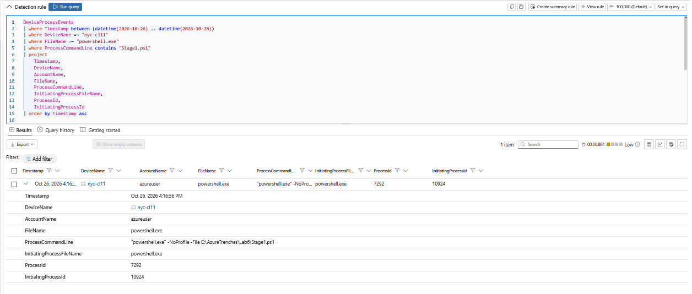

---

## Stage 3 — System Discovery

### Objective

Simulate local host, user, and network discovery on the Windows 11 endpoint and investigate whether Microsoft Defender XDR records the executed commands and their parent-child process relationships.

These commands are legitimate Windows administration utilities but can also be used by adversaries during post-compromise reconnaissance.

### Execution Procedure

The following commands were executed from PowerShell on `nyc-cl11`:

```powershell
whoami /all
systeminfo
ipconfig /all
net user
```

Each command gathered a different category of information:

| Command | Purpose |
|---|---|
| `whoami /all` | Enumerate the current user's identity, groups, and privileges |
| `systeminfo` | Retrieve operating system and host configuration details |
| `ipconfig /all` | Enumerate local network adapter and IP configuration |
| `net user` | Enumerate local user accounts |

### KQL — Discovery Activity Investigation

Microsoft Defender XDR Advanced Hunting was used to identify the discovery commands:

```kql
DeviceProcessEvents
| where Timestamp > ago(24h)
| where DeviceName =~ "nyc-cl11"
| where FileName in~ (
    "whoami.exe",
    "systeminfo.exe",
    "ipconfig.exe",
    "net.exe",
    "net1.exe"
)
| project
    Timestamp,
    DeviceName,
    AccountName,
    FileName,
    ProcessCommandLine,
    InitiatingProcessFileName,
    ProcessId,
    InitiatingProcessId
| order by Timestamp asc
```

### Results

Microsoft Defender successfully captured the discovery activity in `DeviceProcessEvents`.

| Observed process | Parent process | Finding |
|---|---|---|
| `whoami.exe` | `powershell.exe` | User and privilege enumeration |
| `systeminfo.exe` | `powershell.exe` | Host configuration discovery |
| `ipconfig.exe` | `powershell.exe` | Network configuration discovery |
| `net.exe` | `powershell.exe` | Local account enumeration |
| `net1.exe` | `net.exe` | Additional child process associated with `net user` |

The discovery commands were executed within a short period, allowing the analyst to correlate the activity as a related sequence.

Of particular interest, Defender captured `net1.exe` as a child of `net.exe`. This illustrates why parent-child process relationships can provide valuable investigative context beyond individual command-line events.

### MITRE ATT&CK Mapping

| Technique | ID | Simulated behavior |
|---|---|---|
| System Owner/User Discovery | T1033 | `whoami /all` |
| System Information Discovery | T1082 | `systeminfo` |
| System Network Configuration Discovery | T1016 | `ipconfig /all` |
| Account Discovery: Local Account | T1087.001 | `net user` |

These mappings describe the observed discovery techniques, not confirmed malicious activity.

### Analyst Findings

The presence of discovery commands alone is insufficient to establish compromise.

An analyst should evaluate:

- The account executing the commands.
- The parent process and execution context.
- The frequency and sequence of discovery activity.
- Whether the commands correlate with other suspicious events.
- Whether the activity was authorized.

In this lab, the commands were explicitly executed as part of a controlled security simulation.

### Evidence


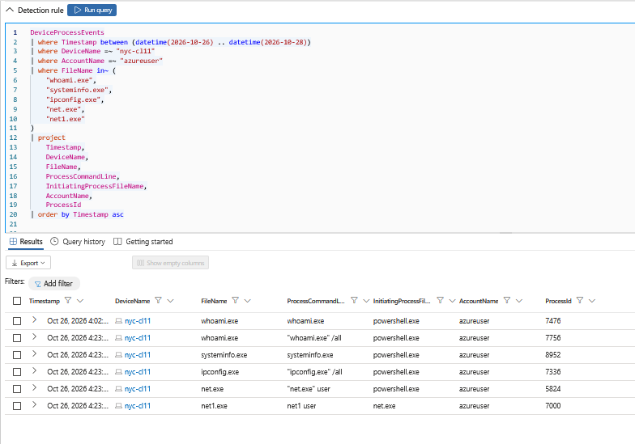


---

## Stage 4 — Scheduled Task Persistence Simulation

### Objective

Simulate the creation and execution of a Windows scheduled task and investigate the resulting endpoint telemetry using Microsoft Defender XDR.

Scheduled tasks are legitimate Windows automation mechanisms but may also be abused by adversaries to execute commands or establish persistence.

This exercise used a benign, one-time scheduled task. It did not establish recurring persistence.

### Execution Procedure

A scheduled task named `AzureTrenches-Lab6` was registered on the Windows 11 endpoint `nyc-cl11`.

The task was configured to launch PowerShell and append the current timestamp to a local text file.

```powershell
$LabPath = "C:\AzureTrenches\Lab6"

$Action = New-ScheduledTaskAction `
    -Execute "powershell.exe" `
    -Argument "-NoProfile -Command `"Get-Date | Out-File '$LabPath\TaskExecution.txt' -Append`""

$Trigger = New-ScheduledTaskTrigger -Once -At (Get-Date).AddMinutes(10)

Register-ScheduledTask `
    -TaskName "AzureTrenches-Lab6" `
    -Action $Action `
    -Trigger $Trigger `
    -Description "Authorized Lab 6 persistence simulation"
```

The task was scheduled to execute approximately ten minutes after registration.

### Execution Validation

Following the scheduled execution time, PowerShell was used to inspect the task's execution status:

```powershell
Get-ScheduledTaskInfo -TaskName "AzureTrenches-Lab6" |
    Select-Object LastRunTime, LastTaskResult, NextRunTime

Get-Content "C:\AzureTrenches\Lab6\TaskExecution.txt"
```

The following results were observed:

| Field | Observed Value |
|---|---|
| Task name | `AzureTrenches-Lab6` |
| Last run time | October 26, 2026, 2:48:10 PM (VM local time) |
| Last task result | `0` — Successful |
| Output artifact | `TaskExecution.txt` |
| Output timestamp | October 26, 2026, 2:48:11 PM |

These findings confirmed that Windows Task Scheduler successfully executed the configured PowerShell action.

### KQL — Scheduled Task Execution Investigation

The following Advanced Hunting query was used to investigate the resulting process execution:

```kql
DeviceProcessEvents
| where Timestamp > ago(24h)
| where DeviceName =~ "nyc-cl11"
| where FileName =~ "powershell.exe"
| where InitiatingProcessFileName =~ "svchost.exe"
| where ProcessCommandLine contains "TaskExecution.txt"
| project
    Timestamp,
    DeviceName,
    AccountName,
    FileName,
    ProcessCommandLine,
    InitiatingProcessFileName,
    ProcessId,
    InitiatingProcessId
| order by Timestamp desc
```

### Results

Microsoft Defender recorded the scheduled PowerShell execution.

| Field | Observed Value |
|---|---|
| Device | `nyc-cl11` |
| Process | `powershell.exe` |
| Process ID | `7068` |
| Parent process | `svchost.exe` |
| Parent process ID | `1964` |
| Account | `azureuser` |
| Defender event time | October 26, 2026, 4:48:10 PM (portal display) |
| Command-line artifact | `TaskExecution.txt` |

The process tree showed the following execution relationship:

```text
wininit.exe
    └── services.exe
         └── svchost.exe
              └── powershell.exe
                   └── Get-Date | Out-File TaskExecution.txt
```

The `svchost.exe` parent process was associated with Windows Task Scheduler services.

This provided additional context connecting the observed PowerShell execution to the scheduled-task activity.

The process telemetry independently confirmed execution of the configured command. It did not, by itself, establish that the original task-registration operation was recorded.

### MITRE ATT&CK Mapping

**T1053.005 — Scheduled Task/Job: Scheduled Task**

Adversaries may abuse Windows scheduled tasks to execute commands or maintain persistence.

In this lab, the technique was emulated using an authorized, one-time task that performed a harmless file-writing operation.

### Analyst Findings

A PowerShell process launched by a Windows service can warrant investigation, but this behavior is not inherently malicious.

Relevant investigative considerations include:

- Whether the task was authorized.
- The parent process and execution context.
- The PowerShell command-line arguments.
- The scheduled-task configuration and execution history.
- Any additional suspicious activity associated with the endpoint.

The task was subsequently unregistered following evidence collection.

### Evidence


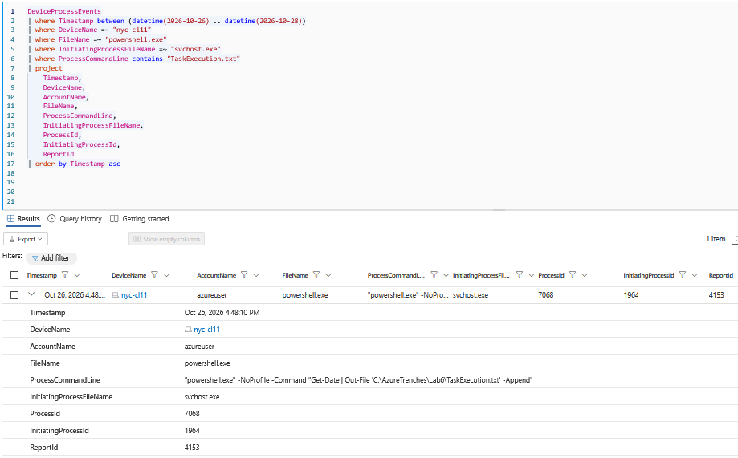

---

## Stage 5 — Outbound HTTPS Communication

### Objective

Simulate outbound HTTPS communication from a Windows 11 endpoint and investigate the resulting network telemetry using Microsoft Defender XDR.

The purpose was to determine whether Defender could associate a network connection with the PowerShell process responsible for initiating it.

This stage used a legitimate public test domain and did not involve command-and-control infrastructure or data exfiltration.

### Execution Procedure

The following command was executed from PowerShell on `nyc-cl11`:

```powershell
Invoke-WebRequest `
    -Uri "https://example.com" `
    -Method GET `
    -UseBasicParsing
```

The command initiated an HTTPS GET request to `example.com`.

PowerShell returned the following response:

| Field | Observed Value |
|---|---|
| Destination | `https://example.com` |
| HTTP status code | `200` |
| Status description | `OK` |
| Protocol | HTTPS |
| Request method | GET |

The successful HTTP response confirmed that the endpoint could communicate with the external destination.

### KQL — Outbound Network Investigation

Microsoft Defender XDR Advanced Hunting was used to investigate the resulting network connection:

```kql
DeviceNetworkEvents
| where Timestamp > ago(24h)
| where DeviceName =~ "nyc-cl11"
| where InitiatingProcessFileName =~ "powershell.exe"
| where RemoteUrl contains "example.com"
| project
    Timestamp,
    DeviceName,
    ActionType,
    InitiatingProcessFileName,
    RemoteUrl,
    RemoteIP,
    RemotePort,
    Protocol,
    InitiatingProcessCommandLine
| order by Timestamp desc
```

### Results

Microsoft Defender successfully recorded the outbound network connection in `DeviceNetworkEvents`.

| Field | Observed Value |
|---|---|
| Device | `nyc-cl11` |
| Action type | `ConnectionSuccess` |
| Initiating process | `powershell.exe` |
| Remote URL | `example.com` |
| Remote IP | `104.20.23.154` |
| Remote port | `443` |
| Protocol | TCP |

The process tree associated the network activity with PowerShell, while the network event identified the external destination and connection details.

This provided visibility into both the process responsible for the communication and the destination it contacted.

### Process-to-Network Correlation

The investigation established the following relationship:

```text
powershell.exe
    |
    +-- Invoke-WebRequest
            |
            +-- HTTPS GET
                    |
                    +-- example.com
                        104.20.23.154:443
```

The PowerShell command returned HTTP `200 OK`, while Defender independently recorded a successful network connection.

These observations were consistent with the authorized test request.

### MITRE ATT&CK Context

**T1071.001 — Application Layer Protocol: Web Protocols**

Adversaries may use HTTP or HTTPS for command-and-control communication.

This lab demonstrated outbound web communication and associated endpoint telemetry. It did not simulate an actual command-and-control channel.

The technique is included as contextual detection-engineering knowledge rather than evidence of malicious C2 activity.

### Analyst Findings

An outbound HTTPS connection alone is insufficient to establish malicious activity.

An analyst should consider:

- The initiating process and its command-line arguments.
- The reputation and purpose of the destination.
- Whether the destination is expected for the endpoint.
- The frequency and timing of connections.
- Whether the communication correlates with suspicious process activity.
- Whether any evidence of data exfiltration or command-and-control behavior exists.

In this case, the destination was a legitimate test domain, the request was authorized, and no malicious network activity was identified.

### Evidence


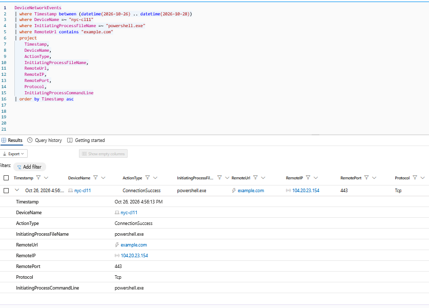

---

## Stage 6 — Custom Detection Engineering

### Objective

Develop and validate a Microsoft Defender XDR custom detection rule capable of identifying PowerShell execution initiated by a Windows service process.

The detection was scoped to the authorized Lab 6 endpoint and a known test artifact to avoid generating unrelated alerts.

### Detection Hypothesis

PowerShell execution initiated by `svchost.exe` may warrant investigation, particularly when the command line references an unexpected scheduled-task artifact.

However, this parent-child relationship is not inherently malicious. Windows Task Scheduler and legitimate administrative tools can produce similar activity.

The detection therefore focuses on a specific combination of process ancestry, command-line content, and endpoint identity.

### Custom Detection Query

The following KQL represents the final query saved after detection tuning:

```kql
DeviceProcessEvents
| where DeviceName =~ "nyc-cl11"
| where FileName =~ "powershell.exe"
| where InitiatingProcessFileName =~ "svchost.exe"
| where ProcessCommandLine contains "TaskExecution.txt"
| project
    Timestamp,
    DeviceId,
    ReportId,
    DeviceName,
    ProcessId,
    FileName,
    ProcessCommandLine,
    InitiatingProcessFileName,
    AccountName
```

The query identifies PowerShell executions that meet all three conditions:

1. Execution occurred on the authorized endpoint `nyc-cl11`.
2. The initiating process was `svchost.exe`.
3. The command line referenced the controlled `TaskExecution.txt` artifact.

The `Timestamp`, `DeviceId`, and `ReportId` fields were retained for custom detection event identification.

### Detection Rule Configuration

| Setting | Configured Value |
|---|---|
| Rule name | `LAB6 - Scheduled Task PowerShell Execution` |
| Detection platform | Microsoft Defender XDR |
| Data source | `DeviceProcessEvents` |
| Execution frequency | Every hour |
| Lookback period | 1 hour |
| Severity | Low |
| Alert title | `LAB6 - Suspicious Service-Launched PowerShell` |
| Incident correlation | Enabled |
| Automated remediation | None |
| MITRE ATT&CK | T1053 — Scheduled Task/Job |

The rule was intentionally scoped to a known lab artifact rather than designed as a production-ready detection.

### Alert Entity Mapping

The original detection used the PowerShell command line as a weak process identifier.

During the investigation, the associated incident displayed incomplete process details in its evidence panel.

To improve the process entity mapping, the query was updated to return `ProcessId`.

The revised configuration used:

| Entity | Identifier | KQL Column |
|---|---|---|
| Device | DeviceId | `DeviceId` |
| Process | CommandLine | `ProcessCommandLine` |
| Process | ProcessId | `ProcessId` |

The Process entity used the combined **CommandLine + ProcessId** identifier.

This mapping provides more specific process context than command-line-only identification, although process IDs can be reused.

The revised mapping was saved successfully. A new alert was not generated to independently validate whether the modification improved evidence enrichment.

### Detection Validation

The original custom detection successfully matched the scheduled-task PowerShell execution.

| Field | Observed Value |
|---|---|
| Device | `nyc-cl11` |
| Detected process | `powershell.exe` |
| Process ID | `7068` |
| Initiating process | `svchost.exe` |
| Initiating process ID | `1964` |
| Process execution | October 26, 2026, 4:48:10 PM (portal display) |
| Alert generated | October 26, 2026, approximately 5:12 PM |
| Alert severity | Low |
| Incident ID | `782` |

The alert was generated by the custom detection rule and associated with Incident #782.

This confirmed that the original rule successfully matched the intended endpoint activity and generated a security alert.

It did not establish that the revised process entity mapping had been independently validated.

### MITRE ATT&CK Mapping

**T1053.005 — Scheduled Task/Job: Scheduled Task**

The detection targeted PowerShell execution associated with the authorized scheduled-task simulation.

The rule configuration selected the Scheduled Task/Job technique, while the more specific sub-technique provides context for the simulated Windows scheduled-task behavior.

### Detection Engineering Lessons

- **Telemetry is not detection:** Endpoint events must be evaluated by detection logic before generating an alert.
- **Process ancestry provides context:** `svchost.exe` launching PowerShell may justify investigation but is not proof of compromise.
- **Entity mapping matters:** Correct identifiers help associate detection results with useful investigative evidence.
- **Alert validation is essential:** A matching hunting query alone does not demonstrate that a scheduled detection rule generated an alert.
- **Detection tuning requires retesting:** Saving an improved rule does not prove that its enrichment behavior changed.
- **Lab detections are not production detections:** Broader deployment would require additional testing, false-positive analysis, and appropriate scoping.

### Evidence


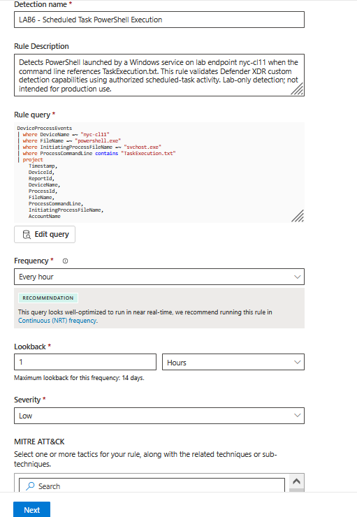

---

## Stage 7 — Incident Investigation and Resolution

### Objective

Investigate the Microsoft Defender XDR incident generated by the Lab 6 custom detection rule, correlate the alert with endpoint telemetry, determine whether the activity represented a security threat, and document the final incident disposition.

### Incident Overview

The custom detection rule `LAB6 - Scheduled Task PowerShell Execution` successfully generated an alert after matching the controlled scheduled-task execution.

Microsoft Defender XDR associated the alert with Incident #782.

| Field | Observed Value |
|---|---|
| Incident ID | `782` |
| Incident title | `LAB6 - Suspicious Service-Launched PowerShell` |
| Severity | Low |
| Impacted device | `nyc-cl11` |
| Alert count | 1 |
| Process evidence items | 1 |
| Detection source | Custom detection |
| MITRE ATT&CK | T1053 — Scheduled Task/Job |
| Final status | Resolved |
| Final classification | Informational, expected activity — Security testing |

### Investigation Procedure

The incident was investigated through the Microsoft Defender XDR incident management interface.

The following investigative steps were performed:

1. Opened the incident generated by the custom detection rule.
2. Reviewed the incident's severity, affected device, and associated alert.
3. Examined the attack story and incident graph.
4. Inspected the alert's process execution timeline.
5. Reviewed the Evidence and Response tab.
6. Examined the associated PowerShell process evidence.
7. Correlated the incident with Advanced Hunting results.
8. Compared the observed behavior against the known authorized lab activity.
9. Classified and resolved the incident.

### Process Tree Investigation

The alert timeline displayed the following process ancestry:

```text
wininit.exe
    └── services.exe
         └── svchost.exe
              └── powershell.exe
```

The associated PowerShell process was launched by `svchost.exe`, consistent with the scheduled-task execution investigated earlier in the lab.

The process command line was:

```powershell
powershell.exe -NoProfile -Command "Get-Date | Out-File 'C:\AzureTrenches\Lab6\TaskExecution.txt' -Append"
```

### Evidence Correlation

Advanced Hunting was used to validate the process details independently of the incident interface.

```kql
DeviceProcessEvents
| where Timestamp > ago(24h)
| where DeviceName =~ "nyc-cl11"
| where ProcessId == 7068
| where ProcessCommandLine contains "TaskExecution.txt"
| project
    Timestamp,
    DeviceName,
    DeviceId,
    ReportId,
    ProcessId,
    ProcessCreationTime,
    FileName,
    ProcessCommandLine,
    InitiatingProcessFileName,
    InitiatingProcessId,
    AccountName
| order by Timestamp desc
```

The investigation confirmed:

| Evidence | Observed Finding |
|---|---|
| Device | `nyc-cl11` |
| Process | `powershell.exe` |
| Process ID | `7068` |
| Parent process | `svchost.exe` |
| Parent process ID | `1964` |
| Account | `azureuser` |
| Command-line artifact | `TaskExecution.txt` |
| Process execution time | October 26, 2026, 4:48:10 PM (Defender portal display) |
| Scheduled task | `AzureTrenches-Lab6` |

The matching command line, process ID, parent process, and known execution window supported the conclusion that the alert originated from the controlled lab activity.

### Evidence and Response Review

The Evidence and Response tab displayed one process evidence item associated with the incident.

The process was marked with a **Suspicious** verdict.

However, the process-details panel did not provide additional file information in that view.

This limitation was documented rather than interpreted as missing telemetry across the entire platform.

The analyst used Advanced Hunting and the known task configuration to establish the process context.

**Important distinction:** A suspicious verdict in an alert does not independently establish malicious activity. The verdict must be evaluated against the available evidence and operational context.

### Incident Classification

The investigation identified several factors supporting an expected-activity classification:

- The scheduled task was deliberately created for an authorized security lab.
- The PowerShell command performed a harmless timestamp-writing operation.
- The task execution time matched the observed Defender process event.
- The command line referenced the known Lab 6 artifact.
- The activity was limited to the designated Windows 11 lab endpoint.
- The task was removed following evidence collection.

The observed behavior was consistent with the controlled simulation rather than an unauthorized intrusion.

### Incident Resolution

Following the investigation, Incident #782 was assigned to the investigating analyst and resolved.

| Resolution Field | Final Value |
|---|---|
| Incident status | Resolved |
| Classification | Informational, expected activity — Security testing |
| Severity | Low |
| Automated remediation | None |
| Scheduled-task cleanup | Completed |
| Lab detection rule | Disabled |

The incident was resolved because the activity had been positively associated with the authorized lab exercise.

No malware removal, device isolation, or account containment was required for this simulation.

### Analyst Conclusion

The custom detection successfully identified the intended service-launched PowerShell execution and generated an actionable alert.

The investigation demonstrated the importance of correlating:

1. Endpoint process telemetry.
2. Parent-child process relationships.
3. Command-line arguments.
4. Scheduled-task execution records.
5. Alert and incident evidence.
6. Known administrative authorization.

The incident was correctly classified as expected security-testing activity after contextual investigation.

**Key takeaway:** Detection identifies behavior that warrants investigation; incident response determines what that behavior actually means.

### Evidence

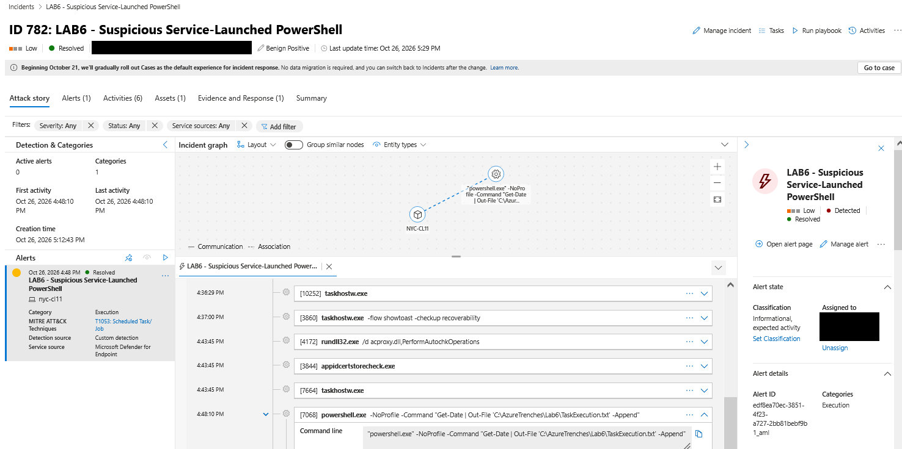

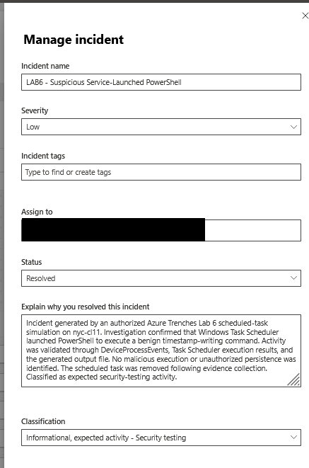


---

## Stage 8 — Final Cleanup, Validation, and Lessons Learned

### Objective

Conclude Operation False Foothold by documenting the cleanup of simulated attack artifacts, validating the known lab state, reviewing detection-engineering outcomes, and identifying opportunities for improvement.

The goal was to leave the environment without the active scheduled task or enabled lab-specific detection rule while preserving useful evidence for future analysis.

### Scheduled Task Cleanup

Following the successful scheduled-task execution and evidence collection, the task was removed using PowerShell:

```powershell
Unregister-ScheduledTask `
    -TaskName "AzureTrenches-Lab6" `
    -Confirm:$false
```

A subsequent verification command was executed:

```powershell
Get-ScheduledTask `
    -TaskName "AzureTrenches-Lab6" `
    -ErrorAction SilentlyContinue
```

The command returned no scheduled-task record.

This confirmed that the simulated scheduled task was no longer registered.

### Remaining Lab Artifacts

The following command was executed to inspect the lab directory:

```powershell
Get-ChildItem "C:\AzureTrenches\Lab6" |
    Select-Object Name, Length, LastWriteTime
```

Two benign files remained at the final verification checkpoint:

| File | Size | Purpose |
|---|---|---|
| `Stage1.ps1` | 185 bytes | Initial PowerShell execution simulation |
| `TaskExecution.txt` | 88 bytes | Scheduled-task execution output |

These files contained authorized lab artifacts and were retained at the time of verification.

The absence of the scheduled task did not mean that all local lab files had been deleted.

### Custom Detection Rule Cleanup

The custom detection rule was disabled after successfully generating the intended alert.

| Field | Final State |
|---|---|
| Rule name | `LAB6 - Scheduled Task PowerShell Execution` |
| Detection platform | Microsoft Defender XDR |
| Validation result | Successfully generated an alert |
| Alert severity | Low |
| Associated incident | #782 |
| Rule status | Disabled |
| Automated remediation | None |

Disabling the rule prevented it from continuing to run as an active scheduled lab detection.

The rule configuration was retained for reference and potential future testing.

### Incident Closure

Incident #782 was investigated and resolved after the observed activity was correlated with the authorized lab exercise.

| Field | Final State |
|---|---|
| Incident ID | `782` |
| Incident title | `LAB6 - Suspicious Service-Launched PowerShell` |
| Severity | Low |
| Status | Resolved |
| Classification | Informational, expected activity — Security testing |
| Scheduled-task cleanup | Completed |
| Automated containment | Not required |

The incident was resolved based on the known task configuration, observed process telemetry, execution timestamps, and authorization context.

### Final Validation Summary

| Validation Objective | Result |
|---|---|
| Defender endpoint onboarding | Confirmed |
| PowerShell process telemetry | Confirmed |
| Host and account discovery telemetry | Confirmed |
| Scheduled-task execution | Confirmed |
| Scheduled-task process ancestry | Confirmed |
| Outbound HTTPS network telemetry | Confirmed |
| Custom detection alert generation | Confirmed |
| Incident creation | Confirmed — #782 |
| Incident investigation | Completed |
| Incident resolution | Completed |
| Scheduled-task removal | Confirmed |
| Custom detection disabled | Confirmed |
| Updated process entity mapping retested | Not performed |
| Final endpoint health recheck | Not documented |

The exercise demonstrated successful telemetry collection, detection execution, alert generation, and incident investigation.

The final validation reflects only the activities actually observed during the lab.

### Lessons Learned

#### 1. Telemetry and Detection Are Different

Microsoft Defender collected endpoint process and network events before a custom detection rule was created.

The existence of telemetry did not automatically mean an alert had been generated.

The custom detection rule provided the logic necessary to convert a specific observed behavior into an alert.

#### 2. Process Ancestry Is Essential Investigative Context

The scheduled-task simulation produced a process relationship involving:

```text
services.exe
    └── svchost.exe
         └── powershell.exe
```

This relationship helped narrow the investigation toward Windows service-initiated execution.

However, legitimate scheduled tasks can produce similar activity.

Parent-child relationships should be evaluated alongside command-line arguments, timing, and authorization.

#### 3. Successful Detection Requires Validation

The custom rule generated a real Low-severity alert associated with Incident #782.

This provided stronger evidence than a successful Advanced Hunting query alone.

A query match demonstrates that telemetry satisfies the hunting conditions; an alert confirms that the detection mechanism executed and produced a security finding.

#### 4. Entity Mapping Affects Investigative Quality

The original alert contained limited process evidence details.

The rule was subsequently updated to use the combined ProcessId and CommandLine identifier.

This improved the specificity of the configured process mapping, but the change was not independently retested with a new alert.

Further validation would be necessary to determine whether the revised mapping improved evidence enrichment.

#### 5. Context Prevents Incorrect Incident Classification

The observed PowerShell execution was consistent with the authorized scheduled-task simulation.

The command line, execution time, parent process, and known lab artifact supported the expected-activity conclusion.

The incident was resolved as:

**Informational, expected activity — Security testing**

This demonstrated the importance of distinguishing suspicious-looking behavior from confirmed malicious activity.

#### 6. Network Telemetry Provides Additional Visibility

The outbound HTTPS simulation generated a successful connection event in `DeviceNetworkEvents`.

Defender identified the initiating PowerShell process, destination domain, remote IP address, and TCP port.

This illustrated how endpoint process telemetry and network telemetry can be correlated during an investigation.

#### 7. Lab Detections Require Careful Production Adaptation

The custom detection was intentionally scoped to a single endpoint and known test artifact.

A production deployment would require:

- Broader behavioral detection logic.
- Baseline analysis of legitimate scheduled-task activity.
- False-positive testing.
- Appropriate alert severity and entity mapping.
- Performance and scheduling considerations.
- Additional validation before enabling automated remediation.

The Lab 6 rule should not be deployed unchanged as a production detection.


### Evidence

#### Scheduled Task Cleanup

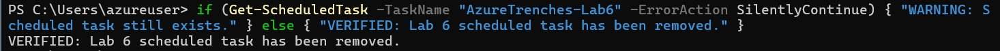

#### Custom Detection Rule Cleanup

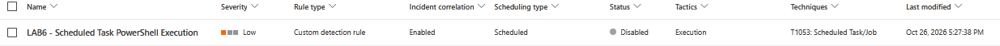


### Limitations

Several limitations should be considered when interpreting the results:

- The exercise used benign commands rather than actual malware.
- The scheduled task executed once and did not establish recurring persistence.
- No unauthorized access, credential theft, exfiltration, or command-and-control activity occurred.
- The custom detection matched a known lab artifact.
- The revised entity mapping was saved but not retested.
- The remaining local files were not deleted at the final verification checkpoint.
- No final endpoint health recheck was documented.
- Hunting queries using relative time filters such as `ago(24h)` may no longer return the original events after the lookback window expires.

### Future Improvements

Future iterations of Operation False Foothold could include:

1. Retesting the revised process entity mapping to evaluate evidence enrichment.
2. Developing a broader behavioral detection that does not rely on the `TaskExecution.txt` filename.
3. Comparing benign administrative scheduled tasks with suspicious execution patterns.
4. Correlating Windows Task Scheduler operational logs with Defender process telemetry.
5. Evaluating alert frequency, false positives, and entity enrichment across multiple test executions.
6. Building a unified KQL hunting timeline combining process and network activity.
7. Replacing evidence placeholders with redacted screenshots of the observed lab results.

### Final Conclusion

Operation False Foothold demonstrated a complete, controlled endpoint detection-and-response workflow.

The exercise progressed through endpoint validation, initial PowerShell execution, system discovery, scheduled-task execution, outbound HTTPS communication, custom detection engineering, incident investigation, and cleanup.

Microsoft Defender XDR successfully recorded the simulated endpoint behaviors, and the custom detection rule generated a Low-severity alert associated with Incident #782.

The investigation established that the activity was authorized and benign, allowing the incident to be resolved as expected security-testing activity.

The primary outcome was not the execution of an attack, but the ability to **generate observable behavior, investigate the resulting telemetry, develop detection logic, validate an alert, and document an evidence-based incident disposition**.

---

*Operation False Foothold — Lab 6 Complete*

*Azure Trenches | Endpoint Security | Microsoft Defender XDR*
