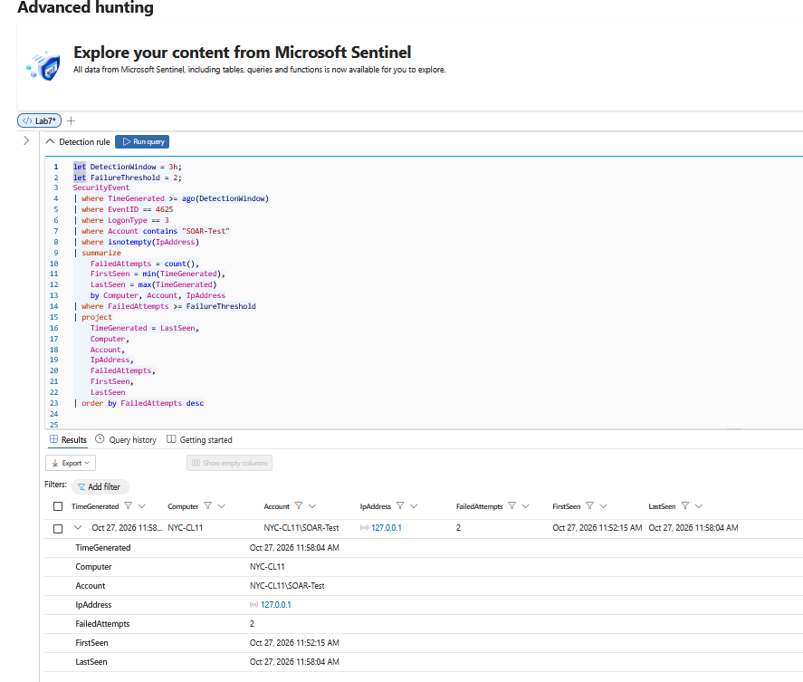
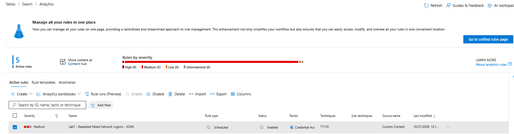
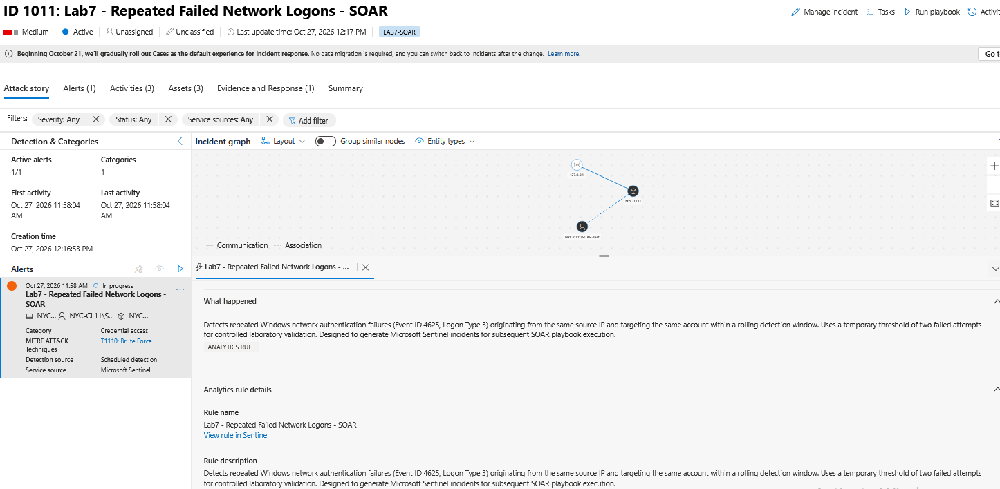
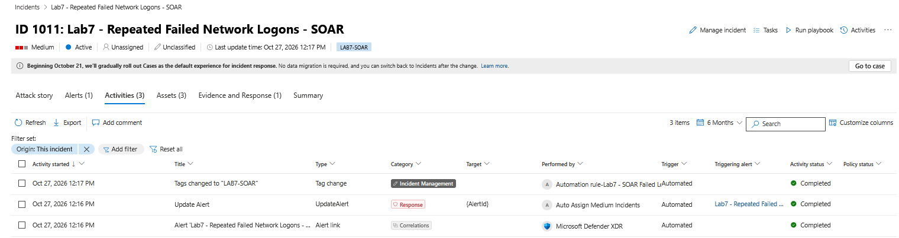

# Lab 7 — Authentication Detection & SOAR Automation
## Overview

This lab demonstrates an end-to-end authentication threat detection workflow using Windows Security Event logs, Microsoft Sentinel, and Microsoft Defender XDR.

A controlled authentication failure scenario was generated against a local Windows account to produce Windows Security Event ID 4625. The resulting telemetry was ingested into Microsoft Sentinel and analyzed using a custom KQL detection query.

A scheduled analytics rule was deployed to identify repeated failed network logons, generate security alerts, and create incidents for investigation.

An incident-triggered automation rule was then configured to apply a classification tag, demonstrating automated incident enrichment within the Microsoft security ecosystem.

## Objectives

- Generate and validate Windows Security Event ID 4625.
- Investigate failed network authentication attempts using KQL.
- Develop a threshold-based detection query.
- Deploy a scheduled Microsoft Sentinel analytics rule.
- Configure account, host, and IP entity mappings.
- Validate alert and incident generation in Microsoft Defender.
- Implement and verify incident-triggered automation.
- Document detection limitations and opportunities for improvement.

## Technologies Used

- Microsoft Sentinel
- Microsoft Defender XDR
- Azure Virtual Machines
- Windows 11
- Windows Security Event Logs
- Kusto Query Language (KQL)
- Microsoft Sentinel Analytics Rules
- Microsoft Sentinel Automation Rules

## MITRE ATT&CK Mapping

**Tactic:** Credential Access

**Technique:** T1110 — Brute Force

The detection models repeated authentication failures that may be associated with brute-force activity. The events were deliberately generated in a controlled lab environment and do not represent a confirmed malicious attack.

## Detection Engineering — Repeated Failed Network Logons

### Scenario

A non-administrative local Windows account named `SOAR-Test` was created on the Azure-hosted Windows 11 virtual machine `NYC-CL11`.

Controlled failed authentication attempts were generated using the Windows `net use` command against the local loopback address (`127.0.0.1`).

The attempts produced Windows Security Event ID **4625**, indicating failed logon activity.

The following event attributes were validated:

| Field | Value | Significance |
|---|---|---|
| Event ID | 4625 | Failed Windows authentication |
| Logon Type | 3 | Network logon attempt |
| Account | SOAR-Test | Controlled test account |
| Source IP | 127.0.0.1 | Local loopback test source |
| Computer | NYC-CL11 | Windows endpoint generating telemetry |

### KQL Detection Query

```kusto
let DetectionWindow = 1h;
let FailureThreshold = 2;
SecurityEvent
| where TimeGenerated >= ago(DetectionWindow)
| where EventID == 4625
| where LogonType == 3
| where Account contains "SOAR-Test"
| where isnotempty(IpAddress)
| summarize
    FailedAttempts = count(),
    FirstSeen = min(TimeGenerated),
    LastSeen = max(TimeGenerated)
    by Computer, Account, IpAddress
| where FailedAttempts >= FailureThreshold
| project
    TimeGenerated = LastSeen,
    Computer,
    Account,
    IpAddress,
    FailedAttempts,
    FirstSeen,
    LastSeen
| order by FailedAttempts desc
```

### Detection Logic

The query searches the `SecurityEvent` table for failed network authentication attempts occurring within a one-hour detection window.

Events are grouped by computer, account, and source IP address. The query calculates the number of failed attempts and identifies the first and last observed timestamps.

A threshold of two failed attempts was selected to demonstrate detection behavior in a controlled lab environment.

**Production consideration:** This threshold is intentionally low and would require tuning to reduce false positives. A production implementation should consider account behavior, source IP reputation, authentication baselines, approved testing activity, and alert suppression.

### Validation Results

The query successfully returned a matching result containing:

- Host: `NYC-CL11`
- Account: `NYC-CL11\SOAR-Test`
- Source IP: `127.0.0.1`
- Failed attempts: `2`

This confirmed successful ingestion of Windows authentication telemetry and execution of the custom KQL detection logic.

## Microsoft Sentinel Analytics Rule Deployment

### Rule Configuration

The validated KQL detection query was deployed as a scheduled Microsoft Sentinel analytics rule.

| Configuration | Value |
|---|---|
| Rule name | Lab7 - Repeated Failed Network Logons - SOAR |
| Rule type | Scheduled |
| Severity | Medium |
| MITRE ATT&CK | Credential Access / T1110 |
| Query frequency | Every 5 minutes |
| Lookup period | Previous 1 hour |
| Alert trigger | Query results greater than 0 |
| Event grouping | All matching results grouped into one alert |
| Suppression | Disabled |
| Incident creation | Enabled |

### Entity Mapping

Three entity types were configured to provide investigation context:

| Entity | Identifier | KQL Column |
|---|---|---|
| Account | Name | Account |
| Host | HostName | Computer |
| IP | Address | IpAddress |

Entity mapping allows Microsoft Defender to associate the resulting alert with the account, endpoint, and source IP observed in the authentication telemetry.

### Incident Grouping

Incident grouping was enabled for matching entities within a five-hour window.

This configuration supports correlation of related alerts into incidents rather than treating every matching detection as an unrelated investigation.

### Detection Outcome

The scheduled analytics rule successfully generated an alert and created Microsoft Defender incident **1011**.

The incident was classified as Medium severity and contained the expected account, host, and IP entities.

This validated the transition from raw Windows security telemetry to an actionable security incident.

## SOAR Automation — Incident Enrichment

### Automation Objective

The objective was to demonstrate an automated response to a Microsoft Sentinel security incident without requiring manual analyst intervention.

An incident-triggered automation rule was configured to apply a classification tag whenever an incident was created by the Lab 7 authentication detection rule.

### Automation Rule Configuration

| Configuration | Value |
|---|---|
| Automation rule | Lab7 - SOAR Failed Logon Response |
| Trigger | When incident is created |
| Condition | Analytics rule name matches the Lab 7 detection |
| Action | Add incident tag |
| Tag | `LAB7-SOAR` |
| Rule order | 1 |
| Expiration | Indefinite |

### Execution Validation

Microsoft Defender incident **1011** was reviewed after the analytics rule generated an alert.

The incident contained the expected classification tag, `LAB7-SOAR`.

The incident activity log independently confirmed that the automation rule executed successfully.

| Validation | Observed Result |
|---|---|
| Incident created | Successful |
| Alert associated with incident | Successful |
| Account, host, and IP entities mapped | Successful |
| Automation rule triggered | Successful |
| `LAB7-SOAR` tag applied | Successful |
| Activity status | Completed |
| Execution type | Automated |

### Operational Significance

Automated incident enrichment can improve SOC triage by applying consistent classifications to security incidents as they are created.

This approach can support incident routing, filtering, reporting, and downstream response workflows.

### Scope and Limitations

This lab implemented Microsoft Sentinel automation-rule-based incident enrichment.

No Azure Logic Apps playbook, automated account disablement, endpoint isolation, or other containment action was deployed.

The successful execution demonstrates automated incident tagging, not automated threat remediation.

## Evidence & Validation

The following screenshots document the successful execution of the detection and incident-enrichment workflow.

### 1. KQL Detection Results

The custom KQL query identified two failed network authentication attempts against the controlled `SOAR-Test` account.

The screenshot uses an expanded three-hour investigation window to retrieve the historical test events; the deployed analytics rule uses a one-hour lookup period.



### 2. Microsoft Sentinel Analytics Rule

The scheduled analytics rule was deployed and enabled with Medium severity and MITRE ATT&CK technique T1110.



### 3. Microsoft Defender Incident Validation

Incident 1011 demonstrates successful alert generation, incident creation, and entity mapping for the account, endpoint, and source IP.



### 4. SOAR Automation Execution

The incident activity log confirms that the Lab 7 automation rule successfully applied the `LAB7-SOAR` tag with a Completed execution status.



## Engineering Findings & Lessons Learned

### Key Findings

1. **Telemetry validation is essential.** Windows Security Event ID 4625 was verified locally before confirming ingestion into Microsoft Sentinel.

2. **Detection engineering requires context.** Filtering by Logon Type 3, account, and source IP provided more focused results than simply counting all failed authentication events.

3. **Entity mapping improves investigation.** Associating the account, endpoint, and IP address with the alert provided additional context in Microsoft Defender's incident graph.

4. **Automation must be validated.** The presence of an automation rule alone does not prove successful execution. The incident activity log confirmed that the `LAB7-SOAR` tag was applied automatically.

### Detection Limitations

- The two-failure threshold was intentionally low for laboratory testing.
- The query specifically targeted the `SOAR-Test` account rather than all accounts.
- The source address `127.0.0.1` represented controlled local testing, not an external attacker.
- A one-hour detection window could miss authentication attempts distributed across longer periods.
- Incident tagging provides classification but does not contain or remediate threats.

### Potential Improvements

- Develop production-oriented thresholds using historical authentication baselines.
- Expand detection coverage to additional accounts and source addresses.
- Add contextual enrichment for privileged accounts and suspicious source IPs.
- Evaluate detection performance against false positives and expected administrative activity.
- Implement an Azure Logic Apps playbook for approved response actions.
- Introduce exception handling, execution monitoring, and safeguards before enabling automated containment.

## Conclusion

This lab demonstrated an end-to-end Microsoft security detection and incident-enrichment workflow, beginning with controlled Windows authentication failures and ending with verified Microsoft Sentinel automation.

The project strengthened practical experience in KQL detection engineering, scheduled analytics rules, MITRE ATT&CK mapping, entity correlation, Microsoft Defender incident investigation, and automated SOC workflows.
