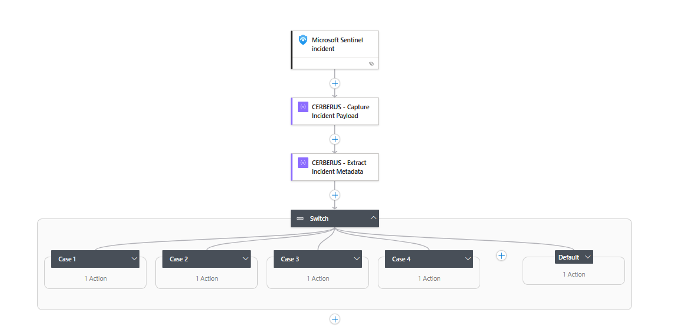
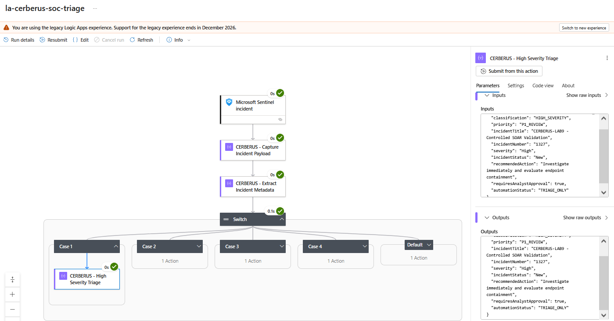
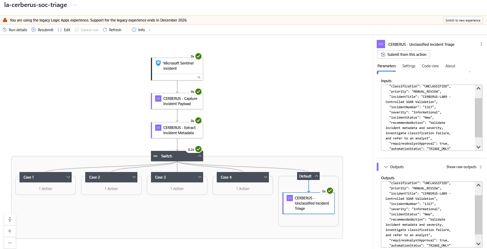

# Lab 09 — CERBERUS: Sentinel SOAR Incident Triage

**Platform:** Microsoft Sentinel | Azure Logic Apps | Microsoft Defender XDR  
**Project Type:** Security Orchestration, Automation & Response (SOAR)  
**Status:** Phase 1 — Implemented and Validated

## Project Overview

CERBERUS is a security orchestration workflow developed to standardize incident triage within Microsoft Sentinel using Azure Logic Apps.

The playbook ingests Sentinel incident metadata, evaluates incident severity, and generates structured triage decisions containing classification, investigation priority, recommended analyst actions, and approval requirements.

The initial implementation supports four severity classifications—High, Medium, Low, and Informational—alongside a default fallback for unclassified incidents.

CERBERUS currently operates in a triage-only configuration, preserving human oversight and preventing automated containment or remediation.

The project is designed for incremental expansion into Defender XDR endpoint investigation, threat intelligence enrichment, and evidence-driven incident response.


## Architecture & Workflow Design

CERBERUS uses a Microsoft Sentinel incident-triggered Azure Logic Apps Consumption workflow to perform structured, severity-based triage.

### Workflow Components

1. **Microsoft Sentinel Incident Trigger** — Receives incident data when the playbook is manually executed against a Sentinel incident.
2. **Incident Payload Capture** — Preserves the incoming trigger payload for inspection and troubleshooting.
3. **Incident Metadata Extraction** — Extracts incident title, severity, incident number, status, and creation timestamp.
4. **Severity-Based Switch** — Evaluates incident severity and routes execution to the corresponding triage branch.
5. **Structured Triage Output** — Produces classification, investigation priority, recommended analyst action, and approval metadata.

### Severity Routing

| Incident Severity | Classification | Priority | Analyst Approval Flag |
|---|---|---|---|
| High | HIGH_SEVERITY | P1_REVIEW | true |
| Medium | MEDIUM_SEVERITY | P2_REVIEW | false |
| Low | LOW_SEVERITY | P3_REVIEW | false |
| Informational | INFORMATIONAL_SEVERITY | P4_REVIEW | false |
| Unmatched / Default | UNCLASSIFIED | MANUAL_REVIEW | true |

The Default branch provides a fallback for unmatched severity values, directing the incident toward manual review.

### Execution Model

The playbook is executed manually from Microsoft Defender's incident interface during development and validation. Its Sentinel automation rule remains disabled.

CERBERUS generates triage recommendations without modifying incidents, isolating endpoints, or executing remediation actions. Analyst approval flags are informational and do not currently constitute an enforced approval workflow.


## Technical Implementation

### 1. Sentinel Incident Ingestion

CERBERUS uses the Microsoft Sentinel incident trigger within an Azure Logic Apps Consumption workflow.

When manually executed against an incident, the trigger provides structured incident data, including severity, title, status, and incident number.

The incoming payload is captured using a Compose action:

```text
@triggerBody()
```

### 2. Incident Metadata Extraction

A second Compose action extracts relevant incident properties from the trigger payload.

The following expressions were validated against the Sentinel incident structure:

```text
triggerBody()?['object']?['properties']?['title']
triggerBody()?['object']?['properties']?['severity']
triggerBody()?['object']?['properties']?['incidentNumber']
triggerBody()?['object']?['properties']?['status']
triggerBody()?['object']?['properties']?['createdTimeUtc']
```

These properties provide the context needed for consistent triage decisions.

### 3. Severity-Based Routing

A Switch control evaluates the incident severity using:

```text
triggerBody()?['object']?['properties']?['severity']
```

The Switch contains four explicit severity cases and a Default branch for unmatched values.

Each branch generates a structured JSON object containing:

- Incident classification and investigation priority
- Incident title, number, severity, and status
- Recommended analyst action
- Analyst approval requirement flag
- Automation status (`TRIAGE_ONLY`)

### 4. Structured Triage Output

The following output was captured during the successful High Severity validation:

```json
{
  "classification": "HIGH_SEVERITY",
  "priority": "P1_REVIEW",
  "incidentTitle": "CERBERUS-LAB9 - Controlled SOAR Validation",
  "incidentNumber": "1327",
  "severity": "High",
  "incidentStatus": "New",
  "recommendedAction": "Investigate immediately and evaluate endpoint containment",
  "requiresAnalystApproval": true,
  "automationStatus": "TRIAGE_ONLY"
}
```

The output provides a consistent triage record that can support future enrichment, reporting, and analyst-driven response workflows.


## Testing & Validation

CERBERUS was validated using a controlled Microsoft Sentinel incident executed manually through the Microsoft Defender incident interface.

**Test Incident:** CERBERUS-LAB9 - Controlled SOAR Validation  
**Sentinel Incident Number:** 1327  
**Execution Method:** Manual playbook invocation  
**Validation Date:** October 30, 2026

### Validation Results

| Test Scenario | Expected Classification | Expected Priority | Result |
|---|---|---|---|
| High Severity | HIGH_SEVERITY | P1_REVIEW | PASS |
| Medium Severity | MEDIUM_SEVERITY | P2_REVIEW | PASS |
| Low Severity | LOW_SEVERITY | P3_REVIEW | PASS |
| Informational Severity | INFORMATIONAL_SEVERITY | P4_REVIEW | PASS |
| Unmatched Severity (Forced Fallback) | UNCLASSIFIED | MANUAL_REVIEW | PASS |

### Validation Criteria

Each severity test confirmed:

- Successful execution of the intended Switch branch
- Correct classification and investigation priority
- Accurate extraction of incident title, number, severity, and status
- Expected recommended analyst action
- Correct analyst approval flag
- `TRIAGE_ONLY` automation status

The Default branch was validated by temporarily supplying an unmatched Switch value. Following validation, the original severity expression was restored and verified.

### Outcome

All five routing paths passed controlled validation. The workflow demonstrated consistent severity-based triage without automated containment, incident modification, or remediation.


## Security Controls & Design Considerations

CERBERUS was developed with controlled execution and human oversight as primary design considerations.

- **Manual Execution:** The playbook is invoked manually against selected Microsoft Sentinel incidents during development and testing.
- **Automation Rule Disabled:** Automatic incident-triggered execution remains disabled to prevent unintended workflow activity.
- **Triage-Only Operation:** The workflow generates structured recommendations without performing containment, remediation, or incident modifications.
- **Analyst Review:** High Severity and Unclassified incidents are flagged for analyst approval. These flags represent triage metadata rather than enforced approval gates.
- **Fallback Handling:** Unexpected severity values are directed to the Default branch for manual review.
- **Controlled Testing:** Validation used a designated test incident, with temporary configuration changes restored after testing.

These controls establish a foundation for future investigation and response automation while minimizing unintended operational impact.

## Engineering Challenges & Lessons Learned

During development, initial workflow executions returned incomplete incident metadata. Investigation identified differences between empty management-trigger test payloads and actual Microsoft Sentinel incident payloads, along with incorrect references to intermediate Compose outputs.

The issue was resolved by inspecting the incoming JSON structure and referencing incident properties directly from the Sentinel trigger.

Following correction, all severity branches were validated successfully.

**Key Takeaway:** Reliable security orchestration depends on understanding connector payload structures, validating workflow expressions, and testing automation against representative incident data.


## Future Enhancements & Development Roadmap

CERBERUS is designed as an extensible security orchestration framework. The initial implementation establishes severity-based incident triage, while future phases will introduce deeper investigation and enrichment capabilities.

### Phase 2 — Defender XDR Endpoint Investigation

Extend CERBERUS to retrieve and analyze endpoint telemetry associated with Microsoft Sentinel incidents.

Planned capabilities include:

- Retrieve incident-associated alerts and affected device information.
- Query Microsoft Defender XDR Advanced Hunting for relevant endpoint activity.
- Examine process execution, parent-child relationships, and command-line evidence.
- Correlate device network connections with suspicious process activity.
- Produce structured investigation findings for analyst review.

### Phase 3 — Threat Intelligence Enrichment

Introduce automated enrichment of incident-related indicators of compromise (IOCs).

Planned capabilities include:

- Extract IP addresses, domains, URLs, and file hashes from incident evidence.
- Query available threat intelligence sources for indicator context.
- Correlate intelligence findings with endpoint and incident telemetry.
- Record indicator matches, source attribution, and confidence limitations.
- Incorporate enrichment results into the triage output.

### Phase 4 — Consolidated Investigation Reporting

Combine severity classification, endpoint evidence, and threat intelligence into a unified investigation summary.

The objective is to provide analysts with actionable context, supporting evidence, and recommended next steps while retaining human oversight of security response decisions.

**Current Project Status:** Phase 1 implemented and validated. Phases 2–4 are planned enhancements and have not yet been implemented.


## Validation Evidence

The following screenshots document the implemented workflow and representative results from controlled validation.

### Workflow Architecture



*Figure 1 — Microsoft Sentinel incident ingestion, metadata extraction, and five severity-routing paths.*

### High Severity Triage



*Figure 2 — Successful High Severity execution demonstrating P1 review classification, populated incident metadata, and analyst approval metadata.*

### Default Fallback Validation



*Figure 3 — Controlled unmatched-value test demonstrating UNCLASSIFIED routing, manual-review priority, and triage-only operation.*


