# Lab 09 — CERBERUS: Sentinel SOAR Incident Triage

**Platform:** Microsoft Sentinel | Azure Logic Apps | Microsoft Defender XDR  
**Project Type:** Security Orchestration, Automation & Response (SOAR)  
**Status:** Phases 1–2.5 — Implemented and Validated | Phase 3 — Planned

## Project Overview

CERBERUS is a security orchestration workflow developed to standardize incident triage within Microsoft Sentinel using Azure Logic Apps.

The playbook ingests Sentinel incident metadata, evaluates incident severity, and generates structured triage decisions containing classification, investigation priority, recommended analyst actions, and approval requirements.

The initial implementation supports four severity classifications—High, Medium, Low, and Informational—alongside a default fallback for unclassified incidents.

CERBERUS currently operates in a triage-only configuration, preserving human oversight and preventing automated containment or remediation.

The project is designed for incremental expansion into Defender XDR endpoint investigation, threat intelligence enrichment, and evidence-driven incident response.


## Architecture & Workflow Design

CERBERUS uses a Microsoft Sentinel incident-triggered Azure Logic Apps Consumption workflow to perform structured, severity-based triage.

### Workflow Components

1. **Microsoft Sentinel Incident Trigger** — Receives incident data when the playbook is manually executed against a Sentinel incident.
2. **Incident Payload Capture** — Preserves the incoming trigger payload for inspection and troubleshooting.
3. **Incident Metadata Extraction** — Extracts incident title, severity, incident number, status, and creation timestamp.
4. **Severity-Based Switch** — Evaluates incident severity and routes execution to the corresponding triage branch.
5. **Structured Triage Output** — Produces classification, investigation priority, recommended analyst action, and approval metadata.

### Severity Routing

| Incident Severity | Classification | Priority | Analyst Approval Flag |
|---|---|---|---|
| High | HIGH_SEVERITY | P1_REVIEW | true |
| Medium | MEDIUM_SEVERITY | P2_REVIEW | false |
| Low | LOW_SEVERITY | P3_REVIEW | false |
| Informational | INFORMATIONAL_SEVERITY | P4_REVIEW | false |
| Unmatched / Default | UNCLASSIFIED | MANUAL_REVIEW | true |

The Default branch provides a fallback for unmatched severity values, directing the incident toward manual review.

### Execution Model

The playbook is executed manually from Microsoft Defender's incident interface during development and validation. Its Sentinel automation rule remains disabled.

CERBERUS generates triage recommendations without modifying incidents, isolating endpoints, or executing remediation actions. Analyst approval flags are informational and do not currently constitute an enforced approval workflow.


## Technical Implementation

### 1. Sentinel Incident Ingestion

CERBERUS uses the Microsoft Sentinel incident trigger within an Azure Logic Apps Consumption workflow.

When manually executed against an incident, the trigger provides structured incident data, including severity, title, status, and incident number.

The incoming payload is captured using a Compose action:

```text
@triggerBody()
```

### 2. Incident Metadata Extraction

A second Compose action extracts relevant incident properties from the trigger payload.

The following expressions were validated against the Sentinel incident structure:

```text
triggerBody()?['object']?['properties']?['title']
triggerBody()?['object']?['properties']?['severity']
triggerBody()?['object']?['properties']?['incidentNumber']
triggerBody()?['object']?['properties']?['status']
triggerBody()?['object']?['properties']?['createdTimeUtc']
```

These properties provide the context needed for consistent triage decisions.

### 3. Severity-Based Routing

A Switch control evaluates the incident severity using:

```text
triggerBody()?['object']?['properties']?['severity']
```

The Switch contains four explicit severity cases and a Default branch for unmatched values.

Each branch generates a structured JSON object containing:

- Incident classification and investigation priority
- Incident title, number, severity, and status
- Recommended analyst action
- Analyst approval requirement flag
- Automation status (`TRIAGE_ONLY`)

### 4. Structured Triage Output

The following output was captured during the successful High Severity validation:

```json
{
  "classification": "HIGH_SEVERITY",
  "priority": "P1_REVIEW",
  "incidentTitle": "CERBERUS-LAB9 - Controlled SOAR Validation",
  "incidentNumber": "1327",
  "severity": "High",
  "incidentStatus": "New",
  "recommendedAction": "Investigate immediately and evaluate endpoint containment",
  "requiresAnalystApproval": true,
  "automationStatus": "TRIAGE_ONLY"
}
```

The output provides a consistent triage record that can support future enrichment, reporting, and analyst-driven response workflows.

## Phase 2 — Defender XDR Endpoint & Network Investigation

### Objective

Extend CERBERUS beyond severity-based triage by collecting endpoint telemetry from Microsoft Defender XDR and consolidating investigation evidence into a structured SOC report.

### Investigation Workflow

Following Sentinel incident ingestion and metadata extraction, CERBERUS performs the following actions:

1. **Device Identification:** Extracts the affected endpoint's Defender Device ID from the incident's Host entities.
2. **Endpoint Telemetry Collection:** Queries `DeviceProcessEvents` for process execution activity associated with the identified device.
3. **Suspicious Process Hunting:** Investigates potentially suspicious process execution, including living-off-the-land binaries (LOLBins).
4. **Behavioral Analysis:** Aggregates process activity to provide additional investigative context.
5. **Network Investigation:** Queries `DeviceNetworkEvents` to retrieve network activity, initiating processes, destination IP addresses, ports, URLs, and connection outcomes.
6. **Evidence Consolidation:** Uses Azure Logic Apps Compose actions to extract query results and assemble a structured JSON investigation report.

### Advanced Hunting — Network Investigation

CERBERUS uses Microsoft Defender XDR Advanced Hunting to retrieve recent network activity for the incident-associated endpoint.

```kql
DeviceNetworkEvents
| where Timestamp > ago(7d)
| where DeviceId == "<DefenderDeviceId>"
| project
    Timestamp,
    DeviceName,
    DeviceId,
    ActionType,
    InitiatingProcessFileName,
    InitiatingProcessId,
    InitiatingProcessCreationTime,
    InitiatingProcessCommandLine,
    RemoteIP,
    RemotePort,
    RemoteUrl,
    LocalIP,
    LocalPort
| order by Timestamp desc
| take 50
```

The Device ID placeholder represents the value dynamically extracted from the Sentinel incident during workflow execution.

### Consolidated Investigation Report

CERBERUS generates a structured JSON report containing:

- `IncidentMetadata` — Incident title, severity, status, number, and creation timestamp.
- `EndpointTelemetry` — Retrieved endpoint process execution records.
- `ProcessInvestigation` — Results from suspicious process hunting.
- `BehavioralAnalysis` — Aggregated process behavior.
- `NetworkInvestigation` — Retrieved network events and process-attributed connection details.
- `AnalystAssessment` — Investigation disposition and recommended next action.

The report currently uses the disposition `Pending analyst review` and recommends reviewing collected evidence before containment.

### Phase 2 Validation

CERBERUS was manually executed against controlled Sentinel incident **1327**, associated with endpoint `nyc-cl11`.

The successful execution produced:

| Investigation Component | Validated Result |
|---|---|
| Endpoint telemetry | 2,404 process events |
| Suspicious process investigation | 20 records |
| Behavioral analysis | 13 summary records |
| Network investigation | 50 network events |
| Consolidated report | Successfully generated |
| Analyst assessment | Pending analyst review |

The network investigation returned process-associated connections, including `svchost.exe` communicating with `v20.events.data.microsoft.com` over HTTPS (TCP port 443).

This represents observed endpoint network telemetry, not confirmed malicious communication.

### Limitations and Security Considerations

- The playbook remains manually invoked; automatic Sentinel execution is disabled.
- CERBERUS does not currently perform endpoint isolation or automated remediation.
- Process and network evidence are collected, but automated cross-dataset process-to-network correlation has not yet been implemented.
- The current analyst assessment is a static recommendation, not an enforced approval gate.
- The network query retrieves the latest 50 matching events within seven days, not every event in that period.
- Evidence intended for public documentation must be reviewed for credentials, secrets, and sensitive environment identifiers.

**Phase 2 Outcome:** Successfully implemented and validated automated Defender XDR endpoint and network evidence collection with consolidated SOC investigation reporting.

## Testing & Validation

CERBERUS was validated using a controlled Microsoft Sentinel incident executed manually through the Microsoft Defender incident interface.

**Test Incident:** CERBERUS-LAB9 - Controlled SOAR Validation  
**Sentinel Incident Number:** 1327  
**Execution Method:** Manual playbook invocation  
**Validation Date:** October 30, 2026

### Validation Results

| Test Scenario | Expected Classification | Expected Priority | Result |
|---|---|---|---|
| High Severity | HIGH_SEVERITY | P1_REVIEW | PASS |
| Medium Severity | MEDIUM_SEVERITY | P2_REVIEW | PASS |
| Low Severity | LOW_SEVERITY | P3_REVIEW | PASS |
| Informational Severity | INFORMATIONAL_SEVERITY | P4_REVIEW | PASS |
| Unmatched Severity (Forced Fallback) | UNCLASSIFIED | MANUAL_REVIEW | PASS |

### Validation Criteria

Each severity test confirmed:

- Successful execution of the intended Switch branch
- Correct classification and investigation priority
- Accurate extraction of incident title, number, severity, and status
- Expected recommended analyst action
- Correct analyst approval flag
- `TRIAGE_ONLY` automation status

The Default branch was validated by temporarily supplying an unmatched Switch value. Following validation, the original severity expression was restored and verified.

### Outcome

All five routing paths passed controlled validation. The workflow demonstrated consistent severity-based triage without automated containment, incident modification, or remediation.


## Security Controls & Design Considerations

CERBERUS was developed with controlled execution and human oversight as primary design considerations.

- **Manual Execution:** The playbook is invoked manually against selected Microsoft Sentinel incidents during development and testing.
- **Automation Rule Disabled:** Automatic incident-triggered execution remains disabled to prevent unintended workflow activity.
- **Triage-Only Operation:** The workflow generates structured recommendations without performing containment, remediation, or incident modifications.
- **Analyst Review:** High Severity and Unclassified incidents are flagged for analyst approval. These flags represent triage metadata rather than enforced approval gates.
- **Fallback Handling:** Unexpected severity values are directed to the Default branch for manual review.
- **Controlled Testing:** Validation used a designated test incident, with temporary configuration changes restored after testing.

These controls establish a foundation for future investigation and response automation while minimizing unintended operational impact.

## Engineering Challenges & Lessons Learned

During development, initial workflow executions returned incomplete incident metadata. Investigation identified differences between empty management-trigger test payloads and actual Microsoft Sentinel incident payloads, along with incorrect references to intermediate Compose outputs.

The issue was resolved by inspecting the incoming JSON structure and referencing incident properties directly from the Sentinel trigger.

Following correction, all severity branches were validated successfully.

**Key Takeaway:** Reliable security orchestration depends on understanding connector payload structures, validating workflow expressions, and testing automation against representative incident data.


## CERBERUS Development Roadmap

CERBERUS is being developed incrementally, with each phase introducing additional investigation capabilities while maintaining analyst oversight.

### Phase 1 — Sentinel Incident Triage (Completed)

Implemented and validated severity-based incident classification, investigation priority assignment, structured triage output, and fallback handling.

All five severity-routing paths passed controlled testing.

### Phase 2 — Defender XDR Endpoint & Network Investigation (Completed)

Implemented and validated:

- Extraction of incident-associated endpoint identifiers.
- Microsoft Defender XDR Advanced Hunting queries against `DeviceProcessEvents` and `DeviceNetworkEvents`.
- Suspicious process hunting and aggregated behavioral analysis.
- Collection of process-attributed network connection evidence.
- Consolidation of incident, endpoint, process, behavioral, and network telemetry into a structured JSON report.
- Analyst assessment recommending evidence review before containment.

Phase 2 was validated against controlled Sentinel incident 1327 and endpoint `nyc-cl11`.

### Phase 2.5 — Operation Nightfall: Controlled Threat Simulation & Automated Correlation (Completed)
Conduct a safe, controlled adversary-emulation exercise against the designated lab endpoint.

**Implemented and validated capabilities:**

- Generate recognizable suspicious process activity using a harmless test payload.
- Produce outbound network telemetry involving a controlled, non-Microsoft destination.
- Correlate process execution and network connections using device identity, process identifiers, and timestamps.
- Investigate the activity through CERBERUS and document the resulting evidence.
- Distinguish simulated suspicious behavior from confirmed malicious activity.

### Phase 3 — Threat Intelligence Enrichment (Planned)

Extend CERBERUS to enrich indicators extracted from endpoint and network investigations.

Planned capabilities:

- Extract IP addresses, domains, URLs, and file hashes.
- Query supported threat intelligence and reputation sources.
- Record indicator matches, source attribution, timestamps, and confidence limitations.
- Incorporate enrichment findings into the consolidated investigation report.
- Support evidence-based analyst decisions without treating unknown indicators as automatically malicious.

### Phase 4 — Analyst-Approved Endpoint Containment (Planned)

Introduce controlled incident-response actions with explicit analyst authorization.

Planned capabilities:

- Present investigation findings and recommended response actions.
- Require an enforced human approval step before containment.
- Integrate supported Microsoft Defender XDR endpoint isolation actions.
- Record approval decisions, execution results, and investigation outcomes.
- Validate containment safely within the authorized lab environment.

**Current Project Status:** Phases 1, 2, and 2.5 implemented and validated. Phases 3 and 4 remain planned.

## Validation Evidence

The following screenshots document the implemented workflow and representative results from controlled validation.

### Workflow Architecture

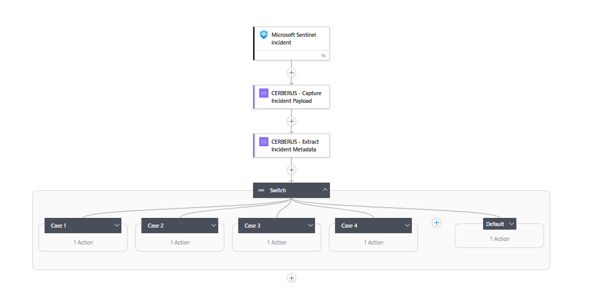

*Figure 1 — Microsoft Sentinel incident ingestion, metadata extraction, and five severity-routing paths.*

### High Severity Triage

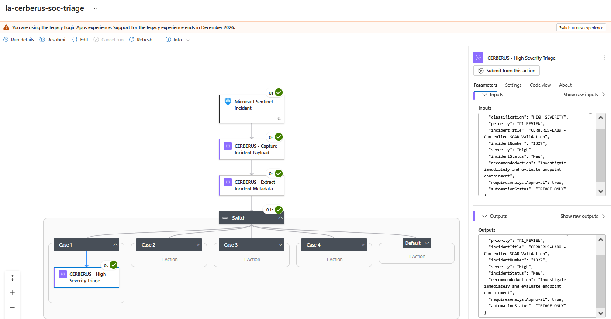

*Figure 2 — Successful High Severity execution demonstrating P1 review classification, populated incident metadata, and analyst approval metadata.*

### Default Fallback Validation

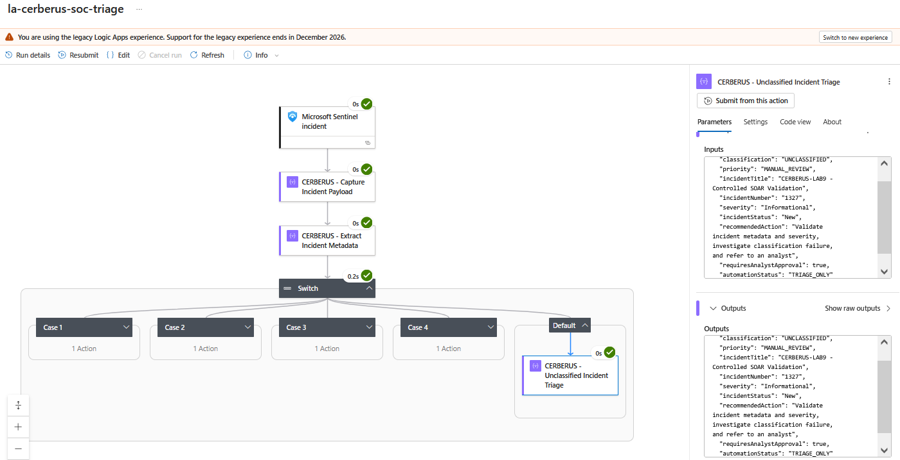

*Figure 3 — Controlled unmatched-value test demonstrating UNCLASSIFIED routing, manual-review priority, and triage-only operation.*

---

## Phase 2 — Defender XDR Investigation Evidence

The following screenshots document the successful execution of CERBERUS's endpoint and network investigation pipeline against controlled Sentinel incident **1327**, associated with endpoint `nyc-cl11`.

### Figure 4 — Network Investigation Workflow

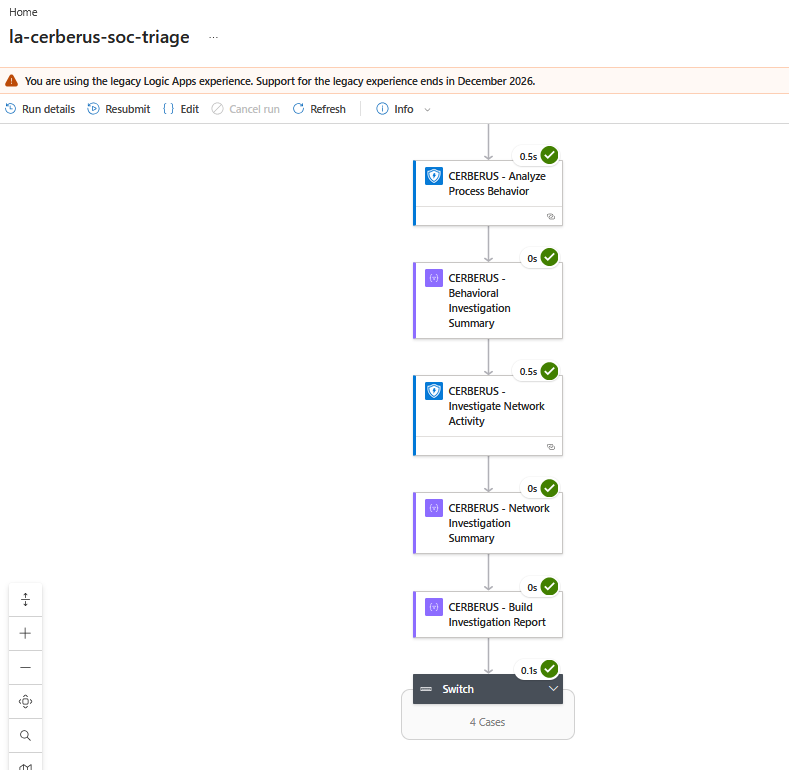

*Figure 4 — Successful Azure Logic Apps execution showing behavioral analysis, Defender XDR network investigation, network evidence extraction, and consolidated investigation reporting.*

### Figure 5 — Defender XDR Network Telemetry

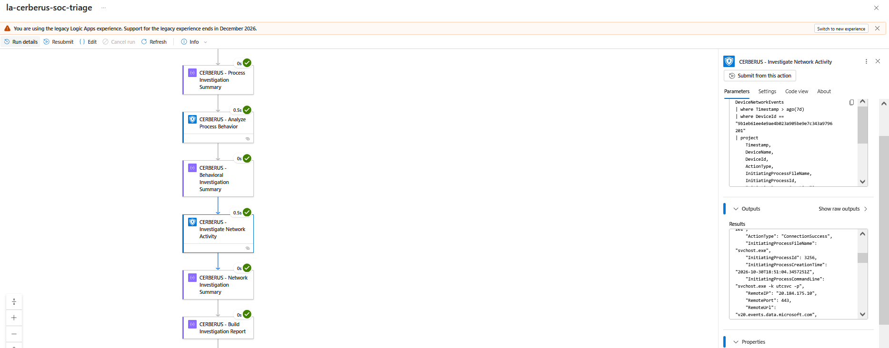

*Figure 5 — Microsoft Defender XDR Advanced Hunting results showing an outbound HTTPS connection initiated by `svchost.exe`, including process attribution, destination IP address, port, and URL.*

### Figure 6 — Network Investigation Summary

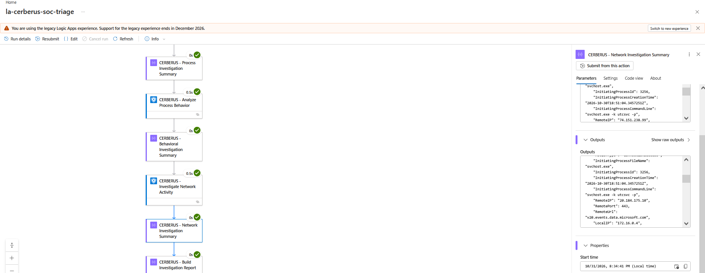

*Figure 6 — Azure Logic Apps Compose action successfully extracting structured `DeviceNetworkEvents` results for downstream investigation reporting.*

### Figure 7 — Consolidated Investigation Report

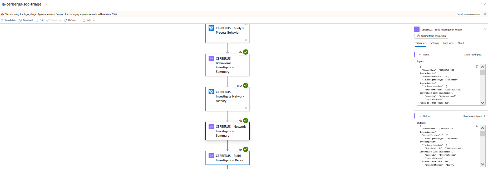

*Figure 7 — Consolidated CERBERUS SOC Investigation report containing incident metadata and structured investigation evidence.*

### Figure 8 — Network Evidence Integration

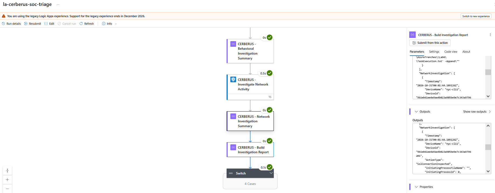

*Figure 8 — `NetworkInvestigation` array successfully incorporated into the consolidated JSON report, demonstrating the transfer of Defender network telemetry through the investigation pipeline.*

### Figure 9 — Analyst Assessment

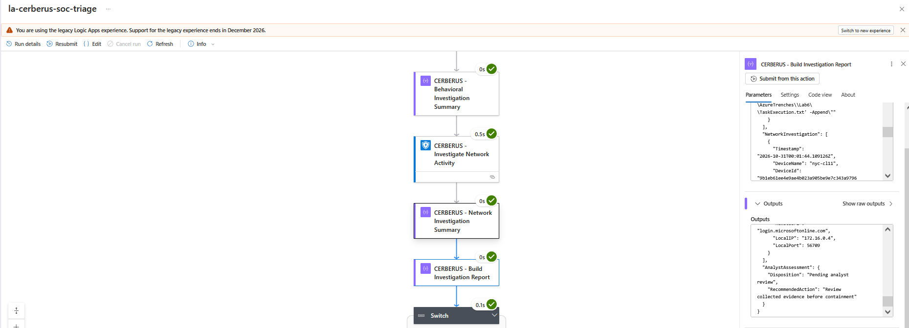

*Figure 9 — Final investigation assessment retaining the disposition `Pending analyst review` and recommending evidence review before containment. No automated containment or enforced approval gate is implemented at this stage.*

### Phase 2 Evidence Summary

The validated workflow successfully retrieved **2,404 endpoint process events**, **20 suspicious-process investigation records**, **13 behavioral summary records**, and **50 network events**.

The results demonstrate automated evidence collection and consolidation rather than confirmed malicious activity. Automated process-to-network correlation, threat intelligence enrichment, and analyst-approved containment remain planned enhancements.


## Phase 2.5 — Operation Nightfall: Automated Process-to-Network Correlation

### Objective

Extend CERBERUS beyond independent endpoint and network investigations by correlating process execution with outbound network activity in Microsoft Defender XDR. Validate the workflow using a controlled, benign PowerShell simulation and incorporate the resulting evidence into the consolidated SOC investigation report.

### Scope

- Generate controlled PowerShell execution and HTTPS connection telemetry on the onboarded Windows 11 endpoint `nyc-cl11`.
- Correlate `DeviceProcessEvents` and `DeviceNetworkEvents` using device identity, process ID, and process creation time.
- Execute the correlation query automatically through the CERBERUS Logic App.
- Include correlated evidence in the `ProcessNetworkCorrelation` section of the consolidated JSON report.
- Validate the results using a known-good Microsoft Sentinel incident payload.

**Safety boundary:** The simulation used the benign example domain `example.com`. A successful outbound connection or PowerShell execution alone does not establish malicious activity. No automated endpoint containment was performed.


### Controlled PowerShell Simulation

A benign PowerShell simulation was executed interactively on the onboarded Windows 11 endpoint `nyc-cl11` to generate observable endpoint process and network telemetry.

The following commands were executed:

```powershell
Invoke-WebRequest -Uri "https://example.com/" -UseBasicParsing -TimeoutSec 15 | Select-Object StatusCode

$NightfallMarker = "CERBERUS-NIGHTFALL-TEST-001"
Write-Output $NightfallMarker
Invoke-WebRequest -Uri "https://example.com/?lab=CERBERUS-NIGHTFALL-TEST-001" -UseBasicParsing -TimeoutSec 15 | Select-Object StatusCode
```

Both HTTPS requests returned HTTP `200`, confirming successful connectivity to the benign test destination.

Microsoft Defender XDR telemetry subsequently identified:

- **Device:** `nyc-cl11`
- **Process:** `powershell.exe`
- **Process ID:** `2568`
- **Account:** `azureuser`
- **Remote destination:** `example.com`
- **Remote IP:** `172.66.147.243`
- **Remote port:** `443`
- **Network action:** `ConnectionSuccess`

The simulation marker was entered within an interactive PowerShell session and should not be interpreted as a marker observed in Defender process command-line telemetry. The observed process command line was `powershell.exe`.

This activity was intentionally benign and was used to validate telemetry collection and correlation rather than malware detection.


### KQL Process-to-Network Correlation

The following KQL query was validated in Microsoft Defender XDR Advanced Hunting. It correlates outbound PowerShell network events with process creation records using device identity, process ID, and process creation time.

```kql
DeviceNetworkEvents
| where Timestamp > ago(24h)
| where DeviceName =~ "nyc-cl11"
| where InitiatingProcessFileName =~ "powershell.exe"
| join kind=inner (
    DeviceProcessEvents
    | where Timestamp > ago(24h)
    | where DeviceName =~ "nyc-cl11"
    | where FileName =~ "powershell.exe"
    | project DeviceId, ProcessId, ProcessCreationTime, ProcessCommandLine, AccountName
)
on DeviceId,
   $left.InitiatingProcessId == $right.ProcessId,
   $left.InitiatingProcessCreationTime == $right.ProcessCreationTime
| project NetworkTimestamp = Timestamp, DeviceName, InitiatingProcessId,
          ProcessCommandLine, AccountName, RemoteUrl, RemoteIP, RemotePort, ActionType
| order by NetworkTimestamp desc
```

**Correlation methodology:** Matching the device and process ID alone can produce incorrect associations when process IDs are reused. Including process creation time strengthens the relationship between the initiating process and its network activity.

The production Logic App action uses a seven-day lookback, a dynamically extracted Defender `DeviceId` from the Sentinel incident context, and a maximum of 50 returned records. The query is used for evidence enrichment, not automatic malicious-activity classification.


### CERBERUS Logic App Integration

The validated KQL correlation was integrated into the existing `la-cerberus-soc-triage` workflow through a Microsoft Defender Advanced Hunting connector action named `CERBERUS - Correlate Process and Network Activity`.

The action was positioned after `CERBERUS - Network Investigation Summary` and before `CERBERUS - Build Investigation Report`.

**Implementation details:**

- Replaced the fixed device-name filter with a dynamically extracted Defender `DeviceId` from the Sentinel incident context.
- Extended the hunting lookback window to seven days for controlled historical validation.
- Limited the query output to 50 records.
- Used an inner join on `DeviceId`, process ID, and process creation time.
- Added the action's `Results` output to the consolidated investigation report under `ProcessNetworkCorrelation`.
- Preserved the existing incident metadata, endpoint telemetry, process investigation, behavioral analysis, network investigation, and analyst assessment sections.

**Validation:** A previously successful Sentinel incident payload was resubmitted to the updated Logic App. The correlation action returned four matching process/network records, and the consolidated investigation report successfully included the Nightfall PowerShell connection to `example.com:443`.

The four records represent correlated activity, not four confirmed threats. The workflow did not perform automated containment or enforce an analyst approval gate.


### Operation Nightfall — Validation Evidence

#### Figure 10 — KQL Process-to-Network Correlation

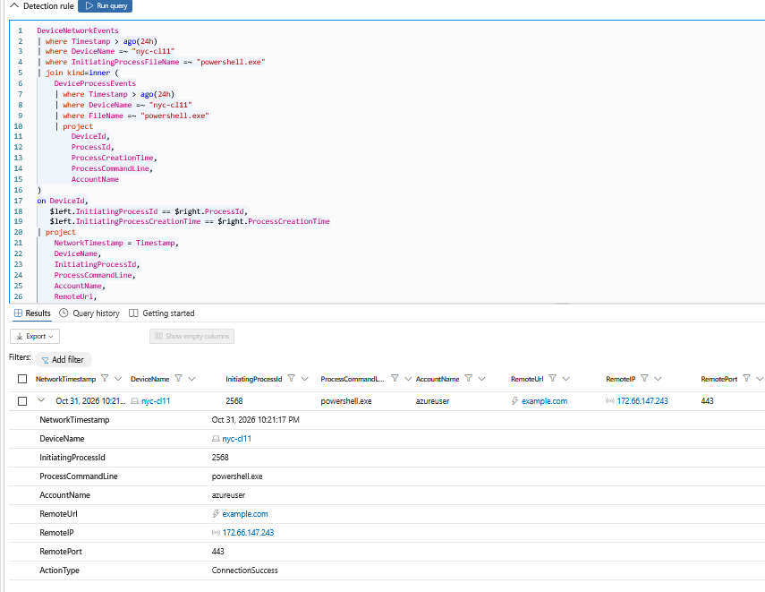

*Figure 10 — Microsoft Defender XDR Advanced Hunting correlation of PowerShell process execution and outbound network activity using device identity, process ID, and process creation time.*

#### Figure 11 — Automated Correlation Results

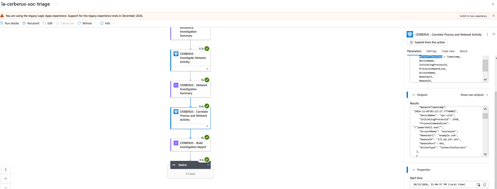

*Figure 11 — Successful CERBERUS Logic App correlation action returning Nightfall PowerShell network evidence, including the connection to `example.com:443`.*

#### Figure 12 — Consolidated Investigation Report

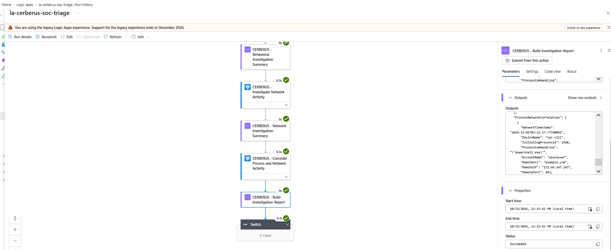

*Figure 12 — Validated Logic App execution showing the `ProcessNetworkCorrelation` section populated within the consolidated investigation report.*


### Phase 2.5 — Validation Summary

Operation Nightfall successfully demonstrated automated process-to-network evidence correlation using Microsoft Defender XDR Advanced Hunting and Azure Logic Apps.

**Validated outcomes:**
- Executed a controlled, benign PowerShell network simulation.
- Correlated endpoint process and network telemetry using device identity, process ID, and process creation time.
- Successfully executed the updated CERBERUS Logic App using a previously validated Sentinel incident payload.
- Retrieved four correlated process/network records, including the Nightfall test activity.
- Added the correlation results to the consolidated investigation report under `ProcessNetworkCorrelation`.

**Current limitations:** Correlated activity was not automatically classified as malicious. Threat intelligence enrichment, enforced analyst approval, and endpoint containment were not implemented or validated in this phase.

**Next phase:** Phase 3 — Threat Intelligence Enrichment.

