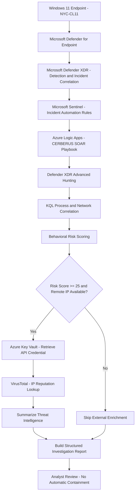

# CERBERUS — System Architecture & Design

## 1. Architecture Overview

CERBERUS is a Microsoft Sentinel and Defender XDR security orchestration, automation, and response (SOAR) lab designed to investigate security incidents through automated endpoint telemetry analysis, behavioral risk scoring, and threat intelligence enrichment.

The solution integrates Microsoft Defender XDR, Microsoft Sentinel, Azure Logic Apps, Azure Key Vault, and the VirusTotal API to produce structured investigation reports for analyst review.

CERBERUS correlates endpoint process execution with outbound network activity using Kusto Query Language (KQL). Correlated events are evaluated against a weighted behavioral risk model, which determines whether additional IP reputation enrichment should occur.

The resulting investigation report combines incident metadata, endpoint evidence, behavioral risk assessment, and available threat intelligence into a single structured output.

The implementation was validated through a controlled, benign encoded PowerShell network simulation. Automated enrichment and report generation were successfully demonstrated without performing automatic endpoint isolation or remediation.


## 2. Technology Stack

CERBERUS integrates Microsoft security services and external threat intelligence to support automated incident investigation and analyst-assisted response.

| Technology | Role in CERBERUS |
|---|---|
| Microsoft Defender for Endpoint | Collects endpoint process and network telemetry from the onboarded Windows 11 virtual machine. |
| Microsoft Defender XDR | Provides Advanced Hunting, custom detection rules, alerts, and incident correlation. |
| Microsoft Sentinel | Provides incident-based automation triggers and orchestration integration. |
| Azure Logic Apps | Hosts the CERBERUS SOAR playbook, investigation queries, conditional logic, and report generation. |
| Kusto Query Language (KQL) | Correlates endpoint process execution with network connections and calculates behavioral risk scores. |
| Azure Key Vault | Stores the VirusTotal API credential for retrieval during enrichment. |
| VirusTotal API | Provides IP reputation data, including malicious, suspicious, harmless, and undetected detection counts. |
| Windows 11 Pro VM | Serves as the Defender-onboarded endpoint for controlled, benign security simulations. |
| GitHub | Hosts project documentation, implementation evidence, and reusable queries. |


## 3. End-to-End Data Flow

CERBERUS follows an incident-driven investigation workflow that connects endpoint detection, Microsoft Sentinel automation, behavioral analysis, and external threat intelligence.

### Stage 1 — Endpoint Telemetry Collection

A Defender-onboarded Windows 11 virtual machine (`nyc-cl11`) generates process execution and network connection telemetry. Microsoft Defender for Endpoint records the relevant activity in `DeviceProcessEvents` and `DeviceNetworkEvents`.

### Stage 2 — Detection and Incident Correlation

A custom Microsoft Defender XDR detection rule identifies encoded PowerShell activity associated with a successful outbound network connection.

Defender XDR generates an alert and correlates it with an incident. During final validation, the new alert was added to existing incident `2471`.

### Stage 3 — Microsoft Sentinel Automation

Microsoft Sentinel evaluates configured automation rules against incident creation or update events.

During final validation, an incident-update automation rule matched the addition of a CERBERUS test alert and invoked the `la-cerberus-soc-triage` Logic App playbook.

### Stage 4 — Automated Endpoint Investigation

The playbook receives incident metadata and performs Defender XDR investigation queries.

CERBERUS retrieves relevant endpoint process and network telemetry, then correlates process execution with outbound connections using KQL.

### Stage 5 — Behavioral Risk Assessment

Correlated events are evaluated using weighted behavioral indicators, including encoded PowerShell execution, download-and-execute patterns, unusual destination ports, and known routine Defender activity.

The resulting risk score is bounded between 0 and 100 and assigned a severity classification.

### Stage 6 — Conditional Threat Intelligence Enrichment

When a remote IP address is available and the selected correlated event meets the configured risk threshold of 25, CERBERUS enters its threat intelligence enrichment branch.

The playbook retrieves the VirusTotal API credential from Azure Key Vault and requests reputation information for the remote IP address.

If the conditions are not satisfied, enrichment is skipped.

### Stage 7 — Investigation Report Generation

CERBERUS generates a structured report containing incident metadata, endpoint evidence, process and network correlation, behavioral risk assessment, available threat intelligence, and an analyst assessment.

The report recommends analyst review before any containment decision.

### Validated Execution

On November 4, 2026, CERBERUS successfully processed incident `2471`, calculated a behavioral risk score of `25` (Medium), enriched remote IP `104.20.23.154` through VirusTotal, and generated a completed investigation report.

The successful Logic App execution completed in approximately 7.92 seconds. No automated endpoint isolation or remediation was performed.


## 4. Logic App Workflow Components

The CERBERUS orchestration engine is implemented as an Azure Logic Apps playbook named `la-cerberus-soc-triage`.

The playbook coordinates incident ingestion, endpoint investigation, behavioral scoring, conditional threat intelligence enrichment, and structured reporting.

### Incident Ingestion and Metadata

The workflow begins with the Microsoft Sentinel incident trigger.

CERBERUS captures the incoming incident payload and extracts relevant metadata, including the incident identifier, alert information, severity, and available endpoint identifiers.

### Endpoint Investigation

The playbook executes Microsoft Defender XDR Advanced Hunting queries to retrieve endpoint evidence.

The investigation examines process execution, behavioral indicators, and outbound network activity. A correlation query associates process events with network connections using endpoint and process identifiers.

### Behavioral Risk Evaluation

CERBERUS evaluates correlated process and network activity using a weighted KQL scoring model.

The resulting assessment contains a numeric risk score, risk classification, remote IP address, and evaluation status.

The current implementation selects the highest-ranked correlated result rather than calculating an aggregate score across the entire incident.

### Conditional Threat Intelligence

A Logic Apps condition checks whether a remote IP address is available and the selected correlated event has a risk score of at least 25.

When both conditions are satisfied, the enrichment branch:

1. Retrieves the VirusTotal API credential from Azure Key Vault.
2. Requests IP reputation information from VirusTotal.
3. Summarizes the returned reputation statistics.
4. Stores the threat intelligence result for reporting.

When the conditions are not satisfied, the external enrichment actions are skipped.

### Investigation Report

The playbook assembles the collected evidence into a structured investigation report.

The report includes incident metadata, endpoint telemetry, process and network findings, behavioral risk assessment, threat intelligence results, and an analyst assessment.

CERBERUS supports analyst decision-making but does not currently perform automated endpoint containment or remediation.

### Severity Routing

The workflow also includes severity-based routing logic for handling incident classifications.

The routing configuration is documented separately in `03-SOAR-Automation.md`, including its implementation and validation status.


## 5. Detection and Incident Automation

CERBERUS uses Microsoft Defender XDR custom detection rules and Microsoft Sentinel automation rules to initiate incident-driven investigations.

### Defender XDR Custom Detection

The final validation detection was named:

`CERBERUS-FINAL-TEST - Encoded PowerShell Network Activity`

The rule identified encoded PowerShell execution associated with a successful outbound connection to the controlled test destination `example.com`.

The detection used `DeviceNetworkEvents` telemetry and was configured with Medium severity, an hourly evaluation schedule, and incident correlation.

### Sentinel Incident Automation

Two Sentinel automation rules were configured for controlled testing:

**Incident Creation Rule**

- Name: `CERBERUS - Controlled Incident Triage`
- Trigger: When an incident is created
- Condition: Incident title contains `CERBERUS-FINAL-TEST`
- Action: Run `la-cerberus-soc-triage`

**Incident Update Rule**

- Name: `CERBERUS - Controlled Incident Update Validation`
- Trigger: When an incident is updated
- Conditions: An alert was added, the incident title contains `Execution incident on one endpoint`, and an alert title contains `CERBERUS-FINAL-TEST`
- Action: Run `la-cerberus-soc-triage`

### Incident Correlation Consideration

During final validation, Defender XDR grouped the new custom detection alert into an existing incident rather than creating a new incident.

The resulting incident retained the generic title `Execution incident on one endpoint`.

Consequently, the incident-creation rule's title condition did not match this scenario. The incident-update rule was designed to handle the addition of the CERBERUS test alert to the existing incident.

### Validated Outcome

The final test involved incident `2471`, which contained the CERBERUS detection alert.

The `la-cerberus-soc-triage` playbook executed successfully on November 4, 2026, at approximately 4:03 PM, processing the incident and producing an enriched investigation report.

The successful run's trigger payload included incident `2471` and the expected CERBERUS alert title.

### Operational Considerations

The incident-update automation rule was configured as a temporary validation rule with an expiration date of November 5, 2026.

These test-specific automation conditions are not intended to serve as unrestricted production incident triggers. The rules should be reviewed and disabled as part of lab cleanup.

Detailed rule configuration, detection KQL, and validation evidence are maintained in the dedicated detection engineering and SOAR automation documentation.


## 6. Behavioral Risk Assessment

CERBERUS implements a custom behavioral risk assessment model using Kusto Query Language (KQL) to evaluate correlated endpoint process and network activity.

The model assigns weighted scores to suspicious behaviors while reducing scores for recognized routine security telemetry.

### Behavioral Scoring Indicators

| Behavioral Indicator | Score Adjustment |
|---|---:|
| Encoded PowerShell command execution | +25 |
| Download-and-execute command patterns | +25 |
| Network connection using an unusual destination port | +20 |
| Recognized routine Microsoft Defender activity | -40 |

The calculated score is constrained to a range of 0–100.

### Risk Classification

| Risk Score | Classification |
|---|---|
| 0–24 | Low |
| 25–49 | Medium |
| 50–69 | High |
| 70–100 | Critical |

### Correlation and Prioritization

CERBERUS correlates endpoint process execution with network activity using device identifiers, process identifiers, and process creation timestamps.

Correlated events are ordered by descending risk score and then by network event timestamp.

The current implementation uses the highest-ranked correlated result for the investigation's behavioral risk assessment. It does not calculate an aggregate risk score across every alert or event in the incident.

### Threat Intelligence Enrichment Threshold

CERBERUS evaluates whether the selected correlated event has a risk score of at least 25 and a nonempty remote IP address.

When both conditions are satisfied, the workflow invokes the VirusTotal enrichment branch.

A score below 25, or an unavailable remote IP address, causes the enrichment branch to be skipped.

### Validated Scoring Behavior

During a benign network investigation, CERBERUS evaluated routine endpoint activity with a risk score of 0, and external threat intelligence enrichment was skipped.

During the final controlled encoded PowerShell simulation on November 4, 2026, the correlated activity received a score of 25 (Medium).

The risk threshold was satisfied, and the playbook successfully executed the VirusTotal enrichment branch.

### Design Considerations

The behavioral weights and classification thresholds are lab-defined heuristics, not statistically calibrated threat probabilities.

A higher score indicates that more configured suspicious indicators were observed; it does not independently establish malicious intent.

VirusTotal reputation results provide additional investigation context but do not currently modify the behavioral risk score.

The complete scoring KQL, field mappings, and implementation details are documented separately in `04-Risk-Scoring.md`.


## 7. Threat Intelligence Enrichment

CERBERUS integrates the VirusTotal API to enrich selected remote IP addresses with external threat intelligence.

Enrichment is conditional rather than unconditional. The playbook performs reputation lookups only when its behavioral risk gate is satisfied.

### Enrichment Decision

The enrichment branch requires both of the following conditions:

1. A nonempty remote IP address is available from correlated endpoint telemetry.
2. The selected correlated event has a behavioral risk score of at least 25.

When either condition is not satisfied, CERBERUS skips the external API lookup.

### API Credential Management

The VirusTotal API credential is stored in Azure Key Vault rather than embedded directly in the Logic App's HTTP request configuration.

During enrichment, the playbook retrieves the credential from Key Vault and uses it to authenticate the VirusTotal API request.

The credential itself must never be included in public GitHub documentation, screenshots, or exported workflow definitions.

### VirusTotal Reputation Lookup

CERBERUS submits the extracted remote IP address to the VirusTotal IP reputation endpoint.

The returned reputation statistics are summarized into a structured threat intelligence object containing:

- Intelligence provider
- Queried IP address
- Malicious detection count
- Suspicious detection count
- Harmless detection count
- Undetected detection count

### Investigation Report Integration

The summarized reputation information is incorporated into the final CERBERUS investigation report alongside endpoint telemetry and behavioral risk findings.

The reputation results supplement analyst investigation rather than automatically determining whether an endpoint should be isolated.

### Validated Enrichment

During the November 4, 2026 end-to-end test, CERBERUS evaluated remote IP `104.20.23.154` and successfully executed the VirusTotal enrichment branch.

The returned reputation statistics were:

| Reputation Category | Result |
|---|---:|
| Malicious | 0 |
| Suspicious | 0 |
| Harmless | 55 |
| Undetected | 37 |

The playbook completed successfully and included these values in its structured investigation report.

### Security and Interpretation

VirusTotal reputation data is contextual intelligence. Zero malicious detections does not establish that an IP address or associated activity is safe.

The current implementation does not automatically isolate endpoints, block indicators, or modify its behavioral risk score based on VirusTotal results.

Detailed API configuration, Key Vault integration, and enrichment expressions are documented separately in `05-Threat-Intelligence.md`.


## 8. Investigation Report Generation

CERBERUS consolidates the results of its automated investigation into a structured JSON report generated by the Logic Apps action `CERBERUS - Build Investigation Report`.

The report brings together incident context, endpoint telemetry, behavioral analysis, process-to-network correlation, risk scoring, and available threat intelligence.

### Investigation Report Structure

| Report Component | Purpose |
|---|---|
| `IncidentMetadata` | Identifies the incident and provides relevant alert and severity context. |
| `EndpointTelemetry` | Contains collected endpoint evidence. |
| `ProcessInvestigation` | Summarizes process execution findings. |
| `BehavioralAnalysis` | Provides behavioral investigation results. |
| `NetworkInvestigation` | Contains outbound network activity findings. |
| `ProcessNetworkCorrelation` | Connects process execution with associated network events. |
| `BehavioralRiskAssessment` | Records the selected risk score, classification, remote IP, and evaluation status. |
| `ThreatIntelligence` | Contains available VirusTotal reputation results. |
| `AnalystAssessment` | Provides the investigation disposition and recommended next action. |

### Validated Investigation Output

During the November 4, 2026 validation, CERBERUS generated the following behavioral risk assessment and threat intelligence results:

```json
{
  "BehavioralRiskAssessment": {
    "RiskScore": 25,
    "RiskLevel": "Medium",
    "RemoteIP": "104.20.23.154",
    "Status": "Evaluated"
  },
  "ThreatIntelligence": {
    "Provider": "VirusTotal",
    "Indicator": "104.20.23.154",
    "MaliciousDetections": 0,
    "SuspiciousDetections": 0,
    "HarmlessDetections": 55,
    "UndetectedDetections": 37
  },
  "AnalystAssessment": {
    "Disposition": "Pending analyst review",
    "RecommendedAction": "Review collected evidence before containment"
  }
}
```

This excerpt represents selected fields from the successful investigation report, not the complete report payload.

### Analyst Decision Support

CERBERUS separates automated evidence collection and enrichment from analyst response decisions.

The investigation report provides a consolidated view of relevant evidence and recommends review before containment.

The current implementation does not enforce an analyst approval workflow or automatically isolate endpoints.

### Validation Evidence

The successful end-to-end execution and final enriched investigation report are preserved in the project screenshot directory:

- [Figure 29 — End-to-End Automation Success](../screenshots/29-CERBERUS-End-to-End-Automation-Success.PNG)
- [Figure 30 — Final Enriched Investigation Report](../screenshots/30-CERBERUS-Final-Enriched-Investigation-Report.PNG)

Detailed report validation and test methodology are maintained in `07-Validation.md`.


## 9. Architecture Diagram

The following diagram illustrates the validated CERBERUS investigation pipeline, including endpoint telemetry collection, incident automation, behavioral risk assessment, conditional threat intelligence enrichment, and structured reporting.



### Architecture Interpretation

The workflow begins with endpoint telemetry collected by Microsoft Defender for Endpoint. Defender XDR evaluates detection logic and correlates alerts into incidents.

Microsoft Sentinel automation invokes the CERBERUS Logic App, which performs endpoint investigation and KQL-based behavioral risk assessment.

The risk gate determines whether external IP reputation enrichment is performed. Both the enriched and non-enriched paths converge on structured investigation report generation.

The final output supports analyst review. Automated endpoint containment is outside the current implementation scope.

### Implementation Evidence

The architecture diagram is a logical representation of the system. Actual Azure Logic Apps designer screenshots and configuration evidence are maintained separately to demonstrate the implemented workflow.

