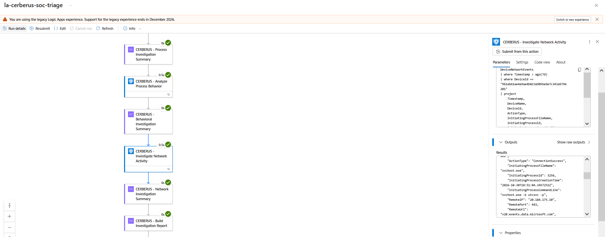
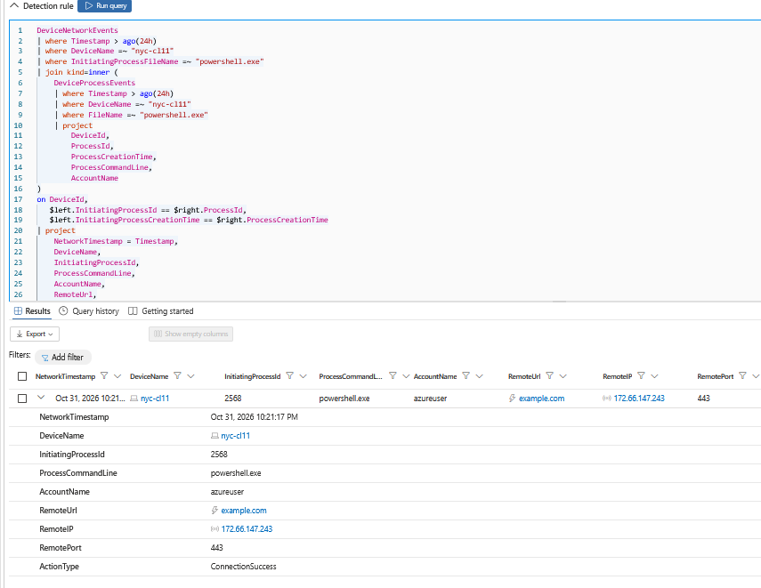
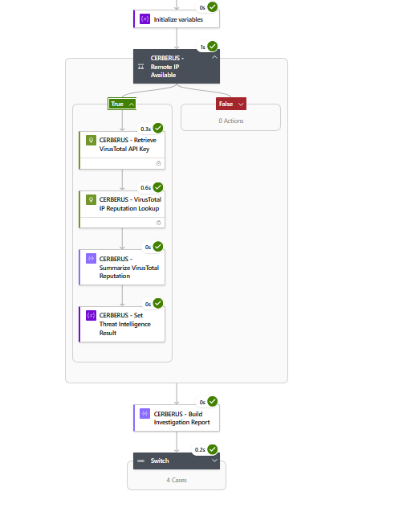

# CERBERUS — Detection Engineering & KQL

## 1. Detection Engineering Overview

CERBERUS uses Microsoft Defender XDR Advanced Hunting and custom detection rules to identify suspicious endpoint activity and provide incident context for automated investigation through Microsoft Sentinel and Azure Logic Apps.

The detection engineering component focuses on observable endpoint behavior, including PowerShell execution, encoded command-line arguments, and associated outbound network connections.

The final validation used a controlled, benign encoded PowerShell simulation on the Defender-onboarded Windows 11 endpoint `nyc-cl11`. Microsoft Defender XDR generated a Medium-severity alert that was correlated into existing incident `2471`.

The resulting incident provided the context for a successful CERBERUS Logic App investigation, behavioral risk assessment, conditional VirusTotal enrichment, and structured report generation.

The detection identifies activity matching configured behavioral conditions; it does not independently establish malicious intent.

## 2. Detection Objectives

The detection engineering implementation was designed to:

- Identify PowerShell-initiated outbound network connections.
- Detect encoded PowerShell command-line execution.
- Correlate relevant process and network telemetry.
- Generate Defender XDR alerts for matching activity.
- Provide incident context for Microsoft Sentinel automation.
- Validate detection behavior using controlled, benign simulations.

Detection configuration, KQL implementation, test methodology, and validation evidence are documented in the following sections.


## 3. Telemetry Sources & Detection Logic

CERBERUS uses Microsoft Defender XDR Advanced Hunting to investigate endpoint process execution and network activity. The final custom detection rule was based on `DeviceNetworkEvents`, while the broader investigation workflow also uses `DeviceProcessEvents`.

### Telemetry Sources

| Data Source | Purpose |
|---|---|
| `DeviceNetworkEvents` | Identifies network connections, initiating processes, destination IP addresses, URLs, ports, and connection outcomes. |
| `DeviceProcessEvents` | Provides process execution details, command-line arguments, process identifiers, and creation timestamps for correlation. |

### Final Custom Detection Query

The following KQL was used for the November 4, 2026 controlled validation:

```kql
DeviceNetworkEvents
| where Timestamp > ago(1h)
| where DeviceName =~ "nyc-cl11"
| where InitiatingProcessFileName =~ "powershell.exe"
| where InitiatingProcessCommandLine contains "-EncodedCommand"
| where RemoteUrl =~ "example.com"
| where ActionType == "ConnectionSuccess"
| project
    Timestamp,
    DeviceId,
    DeviceName,
    ReportId,
    RemoteIP,
    RemoteUrl,
    RemotePort,
    InitiatingProcessId,
    InitiatingProcessCommandLine
```

### Detection Conditions

The query requires all of the following:

1. Network activity observed within the preceding hour.
2. Activity originating from the designated lab endpoint `nyc-cl11`.
3. An outbound connection initiated by `powershell.exe`.
4. A process command line containing `-EncodedCommand`.
5. A remote URL matching the benign test destination `example.com`.
6. A successful network connection recorded as `ConnectionSuccess`.

The endpoint and destination filters intentionally restrict this detection to the controlled lab scenario.

### Detection Interpretation

Encoded PowerShell execution combined with outbound network activity can be relevant to suspicious execution and command-and-control investigations. However, these behaviors can also occur in legitimate administrative workflows.

This detection was designed to validate telemetry visibility, custom alert generation, and downstream incident processing. It does not classify the observed benign simulation as confirmed malicious activity.


## 4. Custom Detection Rule Configuration

The final validation query was configured as a Microsoft Defender XDR custom detection rule to generate an alert when matching endpoint network telemetry was observed.

### Rule Configuration

| Configuration | Validated Setting |
|---|---|
| Rule name | `CERBERUS-FINAL-TEST - Encoded PowerShell Network Activity` |
| Detection platform | Microsoft Defender XDR |
| Data source | `DeviceNetworkEvents` |
| Detection frequency | Every hour |
| Alert severity | Medium |
| MITRE ATT&CK technique | T1059 — Command and Scripting Interpreter |
| Device scope | NYC Client Machines |
| Incident correlation | Enabled |
| Detection environment | Controlled Windows 11 lab endpoint |

### Detection-to-Incident Behavior

During final validation, Defender XDR generated a Medium-severity alert associated with the encoded PowerShell network simulation.

Rather than creating a new incident, Defender correlated the alert into existing incident `2471`, titled `Execution incident on one endpoint`.

This distinction affected downstream automation because the existing incident was updated instead of a new incident being created.

### Engineering Considerations

The rule was deliberately scoped to a known endpoint and benign destination to support reproducible validation.

The hourly evaluation schedule introduces a detection interval; an observed event should not be interpreted as producing an immediate alert.

The detection query and rule configuration demonstrate a controlled proof of concept. Broader production deployment would require tuning, false-positive evaluation, appropriate entity mapping, and validation across additional endpoints and behaviors.


## 5. Controlled PowerShell Simulation

### Test Objective

Generate recognizable encoded PowerShell execution and outbound HTTPS network telemetry on the Defender-onboarded Windows 11 endpoint `nyc-cl11`.

The simulation used a benign request to `https://example.com` to validate the custom detection rule and downstream incident investigation pipeline.

### Simulation Commands

The following PowerShell commands were executed in the authorized lab environment:

```powershell
$script = 'Invoke-WebRequest -Uri "https://example.com" -UseBasicParsing | Out-Null'
$encoded = [Convert]::ToBase64String([Text.Encoding]::Unicode.GetBytes($script))
powershell.exe -NoProfile -EncodedCommand $encoded
```

The command encodes a benign HTTPS request as UTF-16LE Base64 and executes it using PowerShell's `-EncodedCommand` parameter.

This produces a recognizable command-line indicator while allowing Defender for Endpoint to observe the associated process and network activity.

### Observed Telemetry

| Field | Observed Value |
|---|---|
| Endpoint | `nyc-cl11` |
| Initiating process | `powershell.exe` |
| Process ID | `9048` |
| Remote URL | `example.com` |
| Remote IP | `104.20.23.154` |
| Remote port | `443` |
| Network action | `ConnectionSuccess` |
| Event timestamp | November 4, 2026, 3:52:18 PM (lab local time) |

### Validation Interpretation

The observed network event confirmed that Microsoft Defender XDR recorded a successful outbound connection associated with PowerShell execution.

The initiating process command line contained `-EncodedCommand`, satisfying the relevant custom detection condition.

The simulation was intentionally benign. The encoded command was used to validate detection visibility and alert generation, not to demonstrate malware execution, persistence, credential theft, or actual command-and-control activity.


## 6. Detection Results & Incident Correlation

### Defender XDR Detection Outcome

The November 4, 2026 controlled simulation produced endpoint network telemetry matching the CERBERUS custom detection query.

Microsoft Defender XDR generated an alert with the following characteristics:

| Field | Validated Result |
|---|---|
| Detection rule | `CERBERUS-FINAL-TEST - Encoded PowerShell Network Activity` |
| Alert severity | Medium |
| Associated endpoint | `nyc-cl11` |
| Incident number | `2471` |
| Incident title | `Execution incident on one endpoint` |
| Alerts associated with incident | 3 |
| Incident update time | November 4, 2026, approximately 4:01 PM (lab local time) |

### Existing Incident Correlation

Rather than creating a new incident, Defender XDR correlated the CERBERUS alert into existing incident `2471`.

The incident retained its generic title, `Execution incident on one endpoint`, instead of adopting the custom detection rule's name.

This distinction is significant because Microsoft Sentinel automation rules can evaluate incident properties, including titles and update conditions.

### Automation Rule Implications

CERBERUS used two controlled Sentinel automation configurations during validation.

**Incident Creation Rule**

- Rule: `CERBERUS - Controlled Incident Triage`
- Trigger: When an incident is created
- Condition: Incident title contains `CERBERUS-FINAL-TEST`
- Action: Run `la-cerberus-soc-triage`

The creation rule's title condition did not match the final test scenario because the detection alert was grouped into an existing incident with a different title.

**Incident Update Rule**

- Rule: `CERBERUS - Controlled Incident Update Validation`
- Trigger: When an incident is updated
- Conditions: Alert added, incident title contains `Execution incident on one endpoint`, and alert title contains `CERBERUS-FINAL-TEST`
- Action: Run `la-cerberus-soc-triage`

The update rule was configured to handle the observed alert-grouping scenario.

### Validated Investigation Handoff

A successful CERBERUS Logic App run was recorded on November 4, 2026, at approximately 4:03:06 PM.

The execution completed in 7.92 seconds, and its Microsoft Sentinel trigger payload contained incident `2471` and the expected CERBERUS custom detection alert title.

These observations confirm that the playbook successfully processed the intended incident context. The available run evidence does not independently establish which automation rule initiated that execution.

### Detection Engineering Lessons Learned

The final validation demonstrated several important operational considerations:

1. A custom detection alert does not necessarily produce a new incident.
2. Alert correlation can preserve an existing incident title.
3. Incident-creation and incident-update triggers serve different automation scenarios.
4. Automation filters should account for both incident-level and alert-level attributes.
5. Successful detection does not automatically guarantee downstream playbook execution.

These findings highlight the importance of validating the entire detection-to-investigation workflow rather than evaluating custom detection logic in isolation.


## 7. Detection Validation Evidence

The following evidence documents endpoint telemetry visibility, process-to-network correlation, and successful downstream CERBERUS investigation.

### Endpoint Network Telemetry


**Figure 5 — CERBERUS Network Investigation Workflow**



*Earlier Phase 2 Logic Apps evidence showing the retrieval and processing of Defender XDR network telemetry for automated investigation. This screenshot does not demonstrate the final encoded PowerShell detection rule.*

### Process-to-Network Correlation

**Figure 10 — Operation Nightfall KQL Correlation**



*Earlier controlled validation of process-to-network correlation using Defender XDR Advanced Hunting. This demonstrates the correlation methodology subsequently used by CERBERUS.*

### Final Investigation Execution

**Figure 29 — CERBERUS End-to-End Automation Success**



*Successful November 4, 2026 Logic App execution demonstrating conditional threat intelligence enrichment and investigation report generation following incident ingestion.*

### Evidence Scope

The final custom detection configuration and incident `2471` are documented through their observed settings and results in Sections 4 and 6.

The screenshots above support related telemetry, correlation, and investigation capabilities. They should not be interpreted as direct visual evidence of the final custom detection rule configuration or the Defender incident alert list.

Additional screenshots of the final detection rule and incident correlation would strengthen this evidence set if available.


## 8. Detection Limitations & Engineering Considerations

CERBERUS was developed and validated in a controlled Microsoft Defender XDR and Microsoft Sentinel lab environment. The detection logic demonstrates successful telemetry collection, custom alert generation, and downstream investigation, but several limitations must be considered before broader deployment.

### Detection Scope

The final custom detection query contains explicit filters for the lab endpoint `nyc-cl11` and the benign destination `example.com`.

These restrictions support reproducible testing but prevent the rule from identifying equivalent behavior on other endpoints or involving different destinations.

A broader deployment would require replacing these test-specific filters with appropriate device scoping and behavioral conditions.

### False Positives and Detection Evasion

Encoded PowerShell execution is not inherently malicious. Legitimate administrative scripts and automation tools may use encoded commands.

Conversely, suspicious PowerShell activity may not include the exact `-EncodedCommand` argument or generate a successful network connection.

The current rule may therefore produce false positives and false negatives. It does not detect all malicious PowerShell execution techniques.

### Telemetry Dependencies

The detection depends on Microsoft Defender for Endpoint telemetry being collected and available through Microsoft Defender XDR.

Missing endpoint onboarding, telemetry gaps, sensor issues, or unavailable network events can prevent matching activity from appearing in the hunting results.

The rule also relies on initiating-process command-line information being present in `DeviceNetworkEvents`.

### Detection Scheduling and Latency

The final custom detection rule was configured to evaluate every hour using a one-hour KQL lookback.

This configuration does not guarantee immediate alert generation or downstream automation execution.

Detection latency may depend on event ingestion, rule scheduling, alert generation, incident correlation, and Sentinel automation processing.

### Incident Correlation and Automation Reliability

Defender XDR may correlate new alerts into existing incidents rather than creating new incidents.

Automation rules relying exclusively on incident-creation events or incident-title matching may therefore miss relevant alert additions.

The controlled incident-update rule addressed the observed test scenario, but additional validation would be required for other incident states, alert-grouping behaviors, and automation conditions.

### Risk Scoring and Threat Intelligence Boundaries

The downstream CERBERUS behavioral risk model uses lab-defined weighted indicators rather than statistically calibrated threat probabilities.

VirusTotal IP reputation provides additional investigative context but does not independently establish malicious intent or modify the current behavioral risk score.

The investigation report supports analyst review. CERBERUS does not currently enforce an analyst approval workflow or perform automatic endpoint isolation or remediation.

### Production Engineering Considerations

Before considering broader deployment, the detection and investigation pipeline would require:

- Removal of hardcoded lab-specific endpoint and destination filters.
- Testing against representative benign and suspicious activity.
- False-positive analysis and detection tuning.
- Verification of required telemetry fields and device coverage.
- Evaluation of detection latency and incident-correlation behavior.
- Validation of automation-rule conditions and failure handling.
- Review of API credential protection, access permissions, and operational costs.
- Defined analyst response procedures and appropriate approval controls.

### Engineering Conclusion

CERBERUS successfully demonstrated a controlled detection-to-investigation workflow using Defender XDR, Microsoft Sentinel, Azure Logic Apps, KQL correlation, behavioral risk scoring, and conditional VirusTotal enrichment.

The implementation establishes a foundation for further detection engineering and SOAR development while preserving the distinction between observed suspicious behavior, external reputation context, and confirmed malicious activity.

