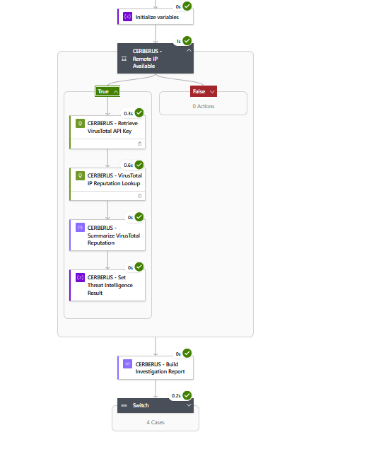
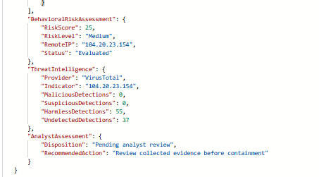

# CERBERUS — SOAR Automation & Logic Apps

## 1. SOAR Automation Overview

CERBERUS is an incident-driven Security Orchestration, Automation, and Response (SOAR) proof of concept built using Microsoft Sentinel, Azure Logic Apps, Microsoft Defender XDR, and Kusto Query Language (KQL).

The workflow automates investigative tasks following the ingestion of relevant security incidents. These tasks include incident metadata extraction, endpoint telemetry collection, process and network investigation, behavioral risk scoring, conditional threat intelligence enrichment, and structured investigation reporting.

The primary Logic App workflow is named `la-cerberus-soc-triage`.

CERBERUS is designed to support analyst decision-making rather than autonomously perform containment or remediation. The current implementation does not isolate endpoints, block network indicators, or enforce a human approval workflow.

### Automation Objectives

The SOAR implementation was designed to:

- Reduce repetitive manual investigation tasks.
- Retrieve relevant Microsoft Defender XDR endpoint telemetry.
- Correlate process execution with network activity.
- Calculate a transparent, rule-based behavioral risk score.
- Perform conditional VirusTotal reputation enrichment.
- Generate structured investigation results for analyst review.
- Preserve evidence of successful and unsuccessful execution paths.

## 2. Automation Components

### Technology Stack

| Component | Role in CERBERUS |
|---|---|
| Microsoft Sentinel | Incident ingestion and automation-rule evaluation |
| Microsoft Defender XDR | Detection, incident correlation, and endpoint investigation data |
| Azure Logic Apps | Workflow orchestration and conditional execution |
| Azure Monitor Logs / KQL | Endpoint telemetry retrieval and behavioral correlation |
| Azure Key Vault | Secure storage and retrieval of the VirusTotal API credential |
| VirusTotal API | External IP reputation enrichment |
| JSON | Structured investigation report output |

### Primary Logic App

**Workflow name:** `la-cerberus-soc-triage`

The Logic App receives incident context through the Microsoft Sentinel incident trigger and executes a sequence of investigation and enrichment actions.

Its orchestration logic includes:

1. Incident payload capture and metadata extraction.
2. Endpoint identification and telemetry retrieval.
3. Process and network investigation.
4. Behavioral correlation and risk scoring.
5. Conditional external threat intelligence enrichment.
6. Structured investigation report generation.
7. Configured severity-based routing.

The November 4, 2026 end-to-end validation confirmed successful investigation, risk assessment, conditional VirusTotal enrichment, and report generation.

Although severity-based routing cases were configured, that validation did not independently establish successful execution of every routing case.


## 3. Microsoft Sentinel Automation Rules

Microsoft Sentinel automation rules evaluate incident events and determine when the CERBERUS Logic App should be invoked.

During the November 4, 2026 validation, two controlled automation rules were configured to evaluate different incident lifecycle events.

### Incident Creation Rule

| Configuration | Value |
|---|---|
| Rule name | `CERBERUS - Controlled Incident Triage` |
| Rule order | 3 |
| Status during validation | Active |
| Trigger | When incident is created |
| Condition | Incident title contains `CERBERUS-FINAL-TEST` |
| Action | Run `la-cerberus-soc-triage` |

This rule was intended to invoke CERBERUS when a newly created Sentinel incident matched the designated test title.

However, the final Defender XDR alert was correlated into an existing incident rather than creating a new one. The existing incident retained the generic title `Execution incident on one endpoint`.

Consequently, the creation rule's trigger and title conditions did not match the observed scenario.

### Incident Update Rule

| Configuration | Value |
|---|---|
| Rule name | `CERBERUS - Controlled Incident Update Validation` |
| Rule order | 5 |
| Status during validation | Active |
| Trigger | When incident is updated |
| Update condition | Alerts added |
| Incident title condition | Contains `Execution incident on one endpoint` |
| Alert title condition | Contains `CERBERUS-FINAL-TEST` |
| Action | Run `la-cerberus-soc-triage` |
| Configured expiration | November 5, 2026, 11:59 PM |

The incident-update rule was designed to handle the alert-grouping behavior observed during final validation.

By evaluating alert additions and alert-level attributes, this configuration avoids relying exclusively on new incident creation.

### Final Validation Behavior

The custom Defender XDR alert was associated with existing incident `2471`.

A successful CERBERUS Logic App execution subsequently processed incident `2471` and the expected custom detection alert.

The available run evidence confirms successful incident processing but does not independently establish which Sentinel automation rule initiated the execution.

### Automation Design Considerations

Incident lifecycle events must be considered when designing reliable Sentinel SOAR workflows.

A detection alert can be grouped into an existing incident, and automation rules restricted to incident creation may not execute for subsequent alert additions.

For production use, automation conditions should be tested against expected incident creation, update, grouping, and deduplication behavior.

The incident-update rule was configured as a temporary validation mechanism rather than a permanent production automation policy.


## 4. Logic App Trigger & Incident Payload Processing

### Microsoft Sentinel Incident Trigger

The CERBERUS Logic App uses the Microsoft Sentinel incident trigger to receive incident context when the playbook is invoked.

The trigger provides structured incident information that the workflow uses to identify the relevant security event and initiate investigation.

During the November 4, 2026 validation, the workflow processed incident `2471`, which contained the expected custom Defender XDR alert.

### Incident Payload Capture

The workflow begins by capturing the incoming incident payload using the action:

`CERBERUS - Capture Incident Payload`

This action preserves the trigger content for subsequent metadata extraction and investigation steps.

### Metadata Extraction

CERBERUS processes the incident payload to retrieve relevant identifiers and alert information.

The workflow includes actions for:

1. Extracting incident metadata.
2. Filtering relevant alert information.
3. Extracting the associated Defender device identifier.
4. Preparing endpoint context for subsequent investigation queries.

These operations establish the relationship between the Sentinel incident and the Defender XDR endpoint telemetry used in later investigation stages.

### Validated Incident Context

The successful November 4 Logic App execution included the following incident context:

| Field | Observed Value |
|---|---|
| Incident ID | `2471` |
| Alert title | `CERBERUS-FINAL-TEST - Encoded PowerShell Network Activity` |
| Logic App | `la-cerberus-soc-triage` |
| Investigation endpoint | `nyc-cl11` |
| Execution outcome | Succeeded |

The observed incident and alert identifiers confirm that the successful workflow run processed the intended controlled detection scenario.

### Investigation Handoff

After extracting the required incident and device context, CERBERUS proceeds to Microsoft Defender XDR investigation queries.

These queries retrieve endpoint process and network telemetry, providing the data required for subsequent behavioral correlation and risk scoring.

The incident payload processing stage is therefore the connection between Sentinel incident automation and the endpoint investigation workflow.


## 5. Automated Endpoint Investigation

### Investigation Overview

After extracting the incident and Defender device context, CERBERUS performs automated endpoint investigation using Microsoft Defender XDR telemetry and Kusto Query Language (KQL).

The workflow examines process execution and network activity to identify potentially suspicious behavior associated with the affected endpoint.

### Endpoint Telemetry Overview

CERBERUS retrieves endpoint context to establish the device being investigated and prepare subsequent hunting queries.

The primary telemetry sources include:

| Telemetry Source | Investigation Purpose |
|---|---|
| `DeviceProcessEvents` | Examine process execution, command-line arguments, process identifiers, and execution timestamps. |
| `DeviceNetworkEvents` | Examine outbound network connections, initiating processes, destination IP addresses, URLs, and ports. |

### Process Investigation

The workflow executes the action:

`CERBERUS - Hunt Suspicious Process Activity`

This stage retrieves relevant process execution telemetry from Defender XDR.

The results are processed through subsequent workflow actions to produce a process investigation summary and evaluate potentially suspicious execution behavior.

Examples of investigated indicators include encoded PowerShell execution and command-line patterns associated with download-and-execute behavior.

### Network Investigation

The workflow executes the action:

`CERBERUS - Investigate Network Activity`

This stage retrieves relevant network telemetry associated with the investigated endpoint.

The investigation considers:

- Remote IP addresses and destination URLs.
- Remote network ports.
- Initiating process information.
- Network activity timestamps.
- Relationships between process execution and outbound connections.

The resulting network investigation summary provides context for subsequent behavioral correlation.

### Investigation Summaries

CERBERUS uses intermediate workflow actions to organize the retrieved telemetry into structured investigation outputs.

These include:

1. Endpoint telemetry overview.
2. Process investigation summary.
3. Behavioral investigation summary.
4. Network investigation summary.

These outputs support downstream correlation, risk assessment, and investigation reporting.

### Investigation Boundaries

The automated investigation is limited to the telemetry available through the configured Defender XDR environment and the KQL queries executed by the workflow.

A missing event or an empty query result does not independently establish that suspicious activity did not occur.

The workflow gathers investigative evidence but does not perform endpoint containment, process termination, or automatic remediation.


## 6. Behavioral Correlation & Risk Scoring

### Behavioral Correlation

Following process and network investigation, CERBERUS executes the workflow action:

`CERBERUS - Correlate Process and Network Activity`

This stage uses KQL to associate endpoint process execution with network activity using device identifiers, process identifiers, and process creation timestamps.

The resulting correlated events provide the input for the behavioral risk assessment.

### Risk Scoring Action

CERBERUS executes:

`CERBERUS - Calculate Behavioral Risk`

The scoring logic evaluates configured behavioral indicators and assigns a weighted risk score to each correlated result.

### Behavioral Scoring Indicators

| Behavioral Indicator | Score Adjustment |
|---|---:|
| Encoded PowerShell command execution | +25 |
| Download-and-execute command patterns | +25 |
| Network connection using an unusual destination port | +20 |
| Recognized routine Microsoft Defender activity | -40 |

The raw score is constrained to a range of 0–100.

The unusual-port indicator applies when a destination port is present and is not `80`, `443`, or `53`.

The routine-activity adjustment reduces the score when the configured query recognizes Defender-related traffic or the `DataCollection.ps1` command pattern.

### Risk Classification

| Risk Score | Classification |
|---|---|
| 0–24 | Low |
| 25–49 | Medium |
| 50–69 | High |
| 70–100 | Critical |

### Risk Result Selection

The correlation query orders results by descending risk score, followed by descending network event timestamp, and limits the returned result set to 50 rows.

The current workflow uses the highest-ranked correlated result for its behavioral risk assessment rather than calculating an aggregate risk score across the entire incident.

Consequently, the reported score should be interpreted as a rule-based assessment of the selected correlated behavior, not as a statistically calibrated probability or an incident-wide threat score.

### Validated Risk Assessment

During the November 4, 2026 controlled validation, CERBERUS produced the following behavioral risk result:

| Field | Observed Value |
|---|---|
| Risk score | `25` |
| Risk level | `Medium` |
| Remote IP | `104.20.23.154` |
| Assessment status | `Evaluated` |

The encoded PowerShell indicator contributed 25 points. The observed HTTPS destination port `443` did not satisfy the unusual-port condition.

### Conditional Enrichment Decision

CERBERUS evaluates the behavioral risk result before invoking external threat intelligence enrichment.

The configured enrichment gate requires:

1. A behavioral risk score of at least `25`.
2. A nonempty remote IP address.

When both conditions are satisfied, the workflow enters the enrichment branch.

When either condition is not satisfied, the workflow bypasses VirusTotal enrichment and continues toward investigation report generation.

### Scoring Boundaries

The behavioral risk model is a transparent, lab-defined heuristic.

A higher score indicates that more configured suspicious indicators were observed; it does not independently prove malicious intent.

VirusTotal reputation results provide additional investigative context but do not currently modify the behavioral risk score.

The complete scoring KQL, field mappings, and implementation details are maintained in [04 — Risk Scoring](04-Risk-Scoring.md).


## 7. Conditional Threat Intelligence Enrichment

### Enrichment Overview

CERBERUS performs conditional external IP reputation enrichment using the VirusTotal API.

The enrichment workflow executes only when the behavioral risk assessment satisfies the configured threshold and a remote IP address is available.

This design avoids unnecessary external reputation lookups for lower-scoring results or investigations without a usable IP indicator.

### Enrichment Decision

The Logic App evaluates the following conditions:

- Behavioral risk score is greater than or equal to `25`.
- Remote IP address is not empty.

When both conditions are satisfied, the workflow enters the True branch and executes the threat intelligence enrichment actions.

Otherwise, the False branch bypasses the external lookup.

Both execution paths converge on investigation report generation.

### Enrichment Workflow Actions

The True branch contains the following actions:

1. `CERBERUS - Retrieve VirusTotal API Key`
2. `CERBERUS - VirusTotal IP Reputation Lookup`
3. `CERBERUS - Summarize VirusTotal Reputation`
4. `CERBERUS - Set Threat Intelligence Result`

The first action retrieves the API credential from Azure Key Vault.

The subsequent actions request VirusTotal reputation information, extract relevant results, and prepare the enrichment output for the final investigation report.

### API Credential Management

The VirusTotal API credential is stored in Azure Key Vault rather than hardcoded into the detection query.

The Logic App retrieves the credential when enrichment is required.

This approach separates credential storage from the investigation logic. Appropriate Key Vault permissions, workflow access controls, and protection of sensitive run-history outputs remain important security considerations.

### Validated Enrichment Result

During the November 4, 2026 validation, CERBERUS enriched the remote IP `104.20.23.154`.

The final investigation report contained:

| Reputation Field | Observed Value |
|---|---|
| Provider | VirusTotal |
| Indicator | `104.20.23.154` |
| Malicious detections | 0 |
| Suspicious detections | 0 |
| Harmless detections | 55 |
| Undetected detections | 37 |

These values represent the reputation results returned during the controlled validation, not a permanent assessment of the IP address.

### Enrichment Interpretation

VirusTotal reputation provides additional context for analyst review.

Zero malicious or suspicious detections does not prove that an IP address is safe.

The current CERBERUS implementation does not use VirusTotal reputation results to modify the behavioral risk score or automatically trigger containment.

### Related Documentation

Detailed threat intelligence configuration and implementation considerations are documented in [05 — Threat Intelligence](05-Threat-Intelligence.md).


## 8. Investigation Report Generation

### Report Generation Overview

After behavioral risk assessment and conditional threat intelligence enrichment, CERBERUS generates a structured investigation report.

The workflow uses the action:

`CERBERUS - Build Investigation Report`

This stage consolidates the available incident context, behavioral risk assessment, threat intelligence results, and analyst guidance into a JSON-formatted investigation output.

Both the enriched and non-enriched execution paths converge on report generation.

### Report Contents

The report is designed to provide analysts with:

- Incident and alert context.
- Endpoint investigation findings.
- Behavioral risk score and classification.
- Relevant remote IP indicator.
- VirusTotal reputation information when enrichment occurs.
- Analyst disposition and recommended next steps.

### Validated Report Fields

The November 4, 2026 final validation included the following report values:

```json
{
  "BehavioralRiskAssessment": {
    "RiskScore": 25,
    "RiskLevel": "Medium",
    "RemoteIP": "104.20.23.154",
    "Status": "Evaluated"
  },
  "ThreatIntelligence": {
    "Provider": "VirusTotal",
    "Indicator": "104.20.23.154",
    "MaliciousDetections": 0,
    "SuspiciousDetections": 0,
    "HarmlessDetections": 55,
    "UndetectedDetections": 37
  },
  "AnalystAssessment": {
    "Disposition": "Pending analyst review",
    "RecommendedAction": "Review collected evidence before containment"
  }
}
```

The JSON above is an excerpt of the validated report rather than a representation of every field in the full output.

### Analyst Review

The report preserves the distinction between behavioral indicators and external reputation information.

A Medium behavioral risk classification does not independently establish malicious activity, and zero VirusTotal malicious detections does not establish that the destination is safe.

The report's analyst disposition remains `Pending analyst review`.

CERBERUS does not currently enforce a human approval step or automatically perform endpoint containment.

### Report Validation

The November 4, 2026 execution successfully generated an enriched investigation report after the behavioral risk gate selected the VirusTotal enrichment branch.

The validated report is preserved in the project evidence directory as Figure 30.

Detailed validation methodology and supporting evidence are documented in [07 — Validation](07-Validation.md).


## 9. Severity Routing & Execution Evidence

### Severity-Based Routing

CERBERUS includes a severity-based `Switch` action with configured routing cases for incident classifications.

The routing structure provides separate branches for:

- Low
- Medium
- High
- Critical

These branches establish a foundation for differentiated incident handling based on classification.

The November 4, 2026 end-to-end validation did not independently demonstrate successful execution of every severity-routing case.

The presence of configured branches should not be interpreted as proof that all routing paths were exercised or validated.

### Successful End-to-End Execution

The November 4, 2026 validation produced a successful execution of the primary CERBERUS investigation workflow.

| Validation Field | Observed Result |
|---|---|
| Logic App | `la-cerberus-soc-triage` |
| Incident | `2471` |
| Detection alert | `CERBERUS-FINAL-TEST - Encoded PowerShell Network Activity` |
| Execution date | November 4, 2026 |
| Start time | Approximately 4:03:06 PM (lab local time) |
| Execution duration | 7.92 seconds |
| Run status | Succeeded |
| Behavioral risk score | `25` |
| Risk classification | Medium |
| Threat intelligence enrichment | Executed |
| Investigation report | Generated |

### Validated Execution Stages

The successful run demonstrated:

1. Sentinel incident context ingestion.
2. Incident metadata and endpoint context processing.
3. Endpoint investigation and behavioral correlation.
4. Behavioral risk evaluation.
5. Execution of the True branch of the enrichment condition.
6. Azure Key Vault credential retrieval.
7. VirusTotal IP reputation lookup and summarization.
8. Structured investigation report generation.

The False enrichment branch and individual severity-routing cases were not independently validated by this final execution.

### Evidence References

The following screenshots preserve the successful execution and generated report:

**Figure 29 — CERBERUS End-to-End Automation Success**



*Successful Logic App execution showing the True enrichment branch and subsequent investigation report generation.*

**Figure 30 — CERBERUS Final Enriched Investigation Report**



*Structured report output containing behavioral risk assessment, VirusTotal reputation context, and analyst guidance.*

### Validation Boundaries

The observed successful run confirms that the documented investigation and enrichment path executed successfully for the controlled test scenario.

It does not establish production reliability, comprehensive error handling, automatic containment capability, or successful execution of every configured routing branch.

Additional execution-path testing would be required before broader operational deployment.

