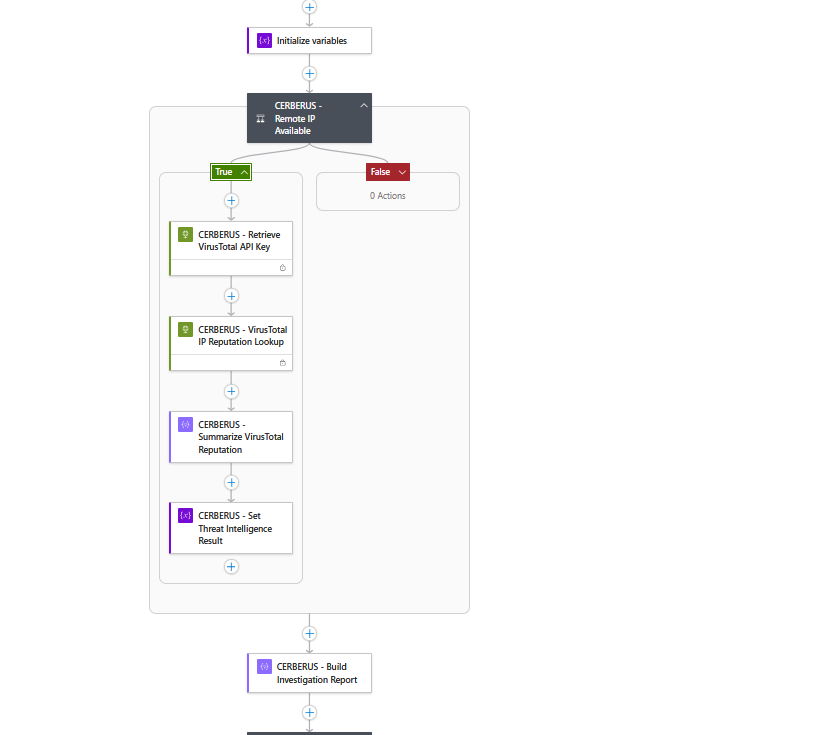
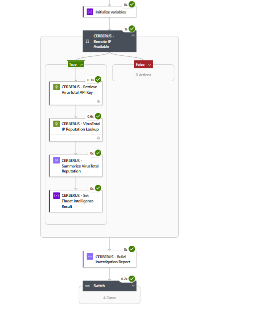
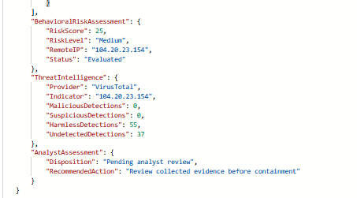

# CERBERUS — Threat Intelligence & Key Vault Integration

## 1. Threat Intelligence Enrichment Overview

CERBERUS integrates external IP reputation intelligence into its automated security investigation workflow using the VirusTotal API.

The enrichment component operates within the Azure Logic App `la-cerberus-soc-triage` and is triggered conditionally based on the results of the behavioral risk assessment.

Rather than performing an external reputation lookup for every investigated event, CERBERUS evaluates the behavioral risk score and availability of a remote IP indicator before proceeding.

### Enrichment Objectives

The threat intelligence component was designed to:

- Enrich selected remote IP addresses with external reputation information.
- Avoid unnecessary API requests for lower-scoring events.
- Retrieve API credentials securely through Azure Key Vault.
- Extract relevant reputation statistics from the VirusTotal response.
- Preserve reputation context in the structured investigation report.
- Support analyst review without automatically declaring an indicator malicious.

### Technology Stack

| Component | Purpose |
|---|---|
| Microsoft Sentinel | Incident context and automation integration |
| Azure Logic Apps | Conditional enrichment orchestration |
| Microsoft Defender XDR | Endpoint investigation and remote IP indicators |
| Azure Key Vault | Secure storage and retrieval of the VirusTotal API credential |
| VirusTotal API | External IP reputation lookup |
| JSON | Structured enrichment results and investigation report output |

### Enrichment Boundaries

VirusTotal reputation data provides additional investigative context. It does not independently establish whether an IP address or associated endpoint activity is malicious.

The current implementation does not automatically block remote IP addresses, isolate endpoints, or modify the behavioral risk score based on VirusTotal results.

## 2. Conditional Enrichment Decision

### Risk-Based Enrichment Gate

CERBERUS evaluates the behavioral risk assessment before initiating external threat intelligence requests.

The configured enrichment condition requires both:

1. A behavioral risk score greater than or equal to `25`.
2. A nonempty remote IP address.

When both requirements are satisfied, the Logic App enters the True branch and executes the enrichment actions.

If either requirement is not satisfied, the workflow follows the False branch and bypasses the external reputation lookup.

Both paths converge on structured investigation report generation.

### Enrichment Workflow

The True branch contains four primary actions:

| Action | Purpose |
|---|---|
| `CERBERUS - Retrieve VirusTotal API Key` | Retrieve the API credential from Azure Key Vault |
| `CERBERUS - VirusTotal IP Reputation Lookup` | Request reputation information for the selected remote IP |
| `CERBERUS - Summarize VirusTotal Reputation` | Extract relevant reputation statistics |
| `CERBERUS - Set Threat Intelligence Result` | Prepare enrichment data for the final report |

### Validated Decision Behavior

During the November 4, 2026 controlled validation, CERBERUS produced a behavioral risk score of `25` and identified remote IP `104.20.23.154`.

The risk score met the configured enrichment threshold, and the remote IP was available.

The Logic App entered the True branch, successfully executed the VirusTotal enrichment actions, and generated the final enriched investigation report.

The successful execution demonstrates the configured enrichment path for this controlled scenario. It does not independently validate every possible condition, API failure, or alternate execution path.

### Related Documentation

The behavioral scoring model and threshold calculations are documented in [04 — Behavioral Risk Scoring & KQL](04-Risk-Scoring.md).

The broader workflow architecture is documented in [01 — System Architecture & Design](01-Architecture.md).


## 3. Azure Key Vault Credential Management

### Credential Security Overview

CERBERUS uses Azure Key Vault to store the VirusTotal API credential separately from its investigation and enrichment logic.

The Logic App retrieves the credential during the conditional enrichment workflow rather than embedding a literal API key directly into its configured actions.

This approach supports separation of sensitive credentials from the investigation logic.

### Credential Retrieval Workflow

When the behavioral risk score meets the configured enrichment threshold and a remote IP address is available, CERBERUS enters the True branch.

The first action executed in this branch is:

`CERBERUS - Retrieve VirusTotal API Key`

This action retrieves the VirusTotal API credential from Azure Key Vault.

The retrieved credential is then made available to the subsequent VirusTotal reputation lookup action.

### Security Considerations

The use of Azure Key Vault improves credential management, but does not independently guarantee that secrets cannot be exposed.

Additional security considerations include:

- Restricting Key Vault access to authorized identities.
- Applying least-privilege permissions to the Logic App.
- Protecting sensitive inputs and outputs in workflow run history.
- Avoiding API credentials in source-controlled documentation or screenshots.
- Rotating API credentials when necessary.
- Reviewing access permissions and secret retrieval failures.

### Implementation Boundaries

The November 4, 2026 successful execution confirms that the workflow retrieved the required credential and completed the subsequent VirusTotal lookup.

The available evidence does not independently establish that every recommended security control, such as secure run-history masking or credential rotation, has been configured.

These controls should be verified before broader operational deployment.


## 4. VirusTotal API Reputation Lookup

### Reputation Lookup Overview

CERBERUS uses the VirusTotal API to retrieve reputation information for the remote IP address selected during behavioral risk assessment.

The lookup executes only when the configured enrichment conditions are satisfied.

### Lookup Workflow

The Logic App executes the action:

`CERBERUS - VirusTotal IP Reputation Lookup`

This action uses the API credential retrieved from Azure Key Vault to request reputation information for the selected remote IP address.

The subsequent action:

`CERBERUS - Summarize VirusTotal Reputation`

extracts relevant reputation statistics from the API response.

### Reputation Fields

The enrichment process captures the following information:

| Field | Purpose |
|---|---|
| `Indicator` | Remote IP address submitted for enrichment |
| `Provider` | Threat intelligence provider |
| `MaliciousDetections` | Number of engines classifying the indicator as malicious |
| `SuspiciousDetections` | Number of engines classifying the indicator as suspicious |
| `HarmlessDetections` | Number of engines classifying the indicator as harmless |
| `UndetectedDetections` | Number of engines without a detection classification |

### Validated Reputation Results

During the November 4, 2026 controlled validation, CERBERUS enriched remote IP `104.20.23.154`.

The final investigation report contained:

| Field | Observed Value |
|---|---|
| Provider | VirusTotal |
| Indicator | `104.20.23.154` |
| Malicious detections | 0 |
| Suspicious detections | 0 |
| Harmless detections | 55 |
| Undetected detections | 37 |

### Reputation Interpretation

The observed VirusTotal response did not report malicious or suspicious detections for the selected IP at the time of the lookup.

However, a reputation result containing zero malicious detections does not establish that an IP address is safe.

Reputation statistics represent external classification information and must be interpreted alongside endpoint behavior, network activity, and other investigation evidence.

CERBERUS preserves this distinction by including VirusTotal results as additional investigation context rather than automatically changing its behavioral risk score or performing containment.


## 5. Threat Intelligence Report Integration

### Enrichment Result Processing

After the VirusTotal reputation lookup completes, CERBERUS processes the returned reputation statistics.

The workflow uses the action:

`CERBERUS - Set Threat Intelligence Result`

This action prepares the enrichment result for inclusion in the structured investigation report.

### Investigation Report Integration

The Logic App subsequently executes:

`CERBERUS - Build Investigation Report`

This action combines the available incident context, behavioral risk assessment, threat intelligence results, and analyst guidance into a JSON-formatted investigation report.

### Validated Threat Intelligence Output

The November 4, 2026 successful execution produced the following threat intelligence report excerpt:

```json
{
  "ThreatIntelligence": {
    "Provider": "VirusTotal",
    "Indicator": "104.20.23.154",
    "MaliciousDetections": 0,
    "SuspiciousDetections": 0,
    "HarmlessDetections": 55,
    "UndetectedDetections": 37
  }
}
```

### Analyst Interpretation

The VirusTotal results provide external reputation context for the selected remote IP address.

The enrichment output does not independently establish malicious intent, change the behavioral risk classification, or trigger automatic endpoint containment.

The final investigation report preserves the analyst disposition:

`Pending analyst review`

The documented recommended action is:

`Review collected evidence before containment`

This approach keeps the final security decision with the analyst rather than treating an external reputation lookup as definitive evidence of malicious activity.

### Execution Path Boundaries

The successful November 4 execution validated the enrichment-enabled reporting path.

When the enrichment gate is not satisfied, CERBERUS bypasses the external lookup and continues toward report generation.

Additional validation would be required to establish how the workflow handles API failures, unavailable credentials, malformed responses, and other exceptional conditions.


## 6. Threat Intelligence Validation Evidence

### Validation Overview

On November 4, 2026, CERBERUS successfully executed its conditional VirusTotal enrichment workflow during a controlled endpoint investigation.

The investigation processed Microsoft Sentinel incident `2471`, evaluated correlated endpoint behavior, and produced a behavioral risk score of `25`.

Because the risk score met the enrichment threshold and a remote IP indicator was available, the Logic App entered the True branch.

The workflow successfully retrieved the VirusTotal API credential, performed an IP reputation lookup, summarized the returned statistics, and incorporated the enrichment results into the final investigation report.

### Conditional Enrichment Workflow

**Figure 34 — CERBERUS Conditional Threat Intelligence Workflow**



*Azure Logic Apps designer showing the conditional enrichment branch, Azure Key Vault credential retrieval, VirusTotal reputation lookup, reputation summarization, and threat intelligence result preparation.*

### Successful Enrichment Execution

**Figure 29 — CERBERUS End-to-End Automation Success**



*Successful November 4, 2026 Logic App execution showing the True enrichment branch and subsequent investigation report generation.*

### Final Enriched Investigation Report

**Figure 30 — CERBERUS Final Enriched Investigation Report**



*Structured investigation output containing behavioral risk assessment, VirusTotal reputation statistics, and analyst guidance.*

### Evidence Interpretation

Figures 29 and 30 provide evidence of successful enrichment execution and structured report generation.

Figure 34 documents the configured conditional enrichment workflow.

Together, these screenshots support the validated implementation but do not establish production reliability, comprehensive error handling, or successful execution of every possible workflow branch.

### Related Documentation

The broader investigation workflow is documented in [03 — SOAR Automation & Logic Apps](03-SOAR-Automation.md).

The system architecture and additional implementation screenshots are documented in [01 — System Architecture & Design](01-Architecture.md).


## 7. Security Limitations & Future Improvements

### Current Implementation Limitations

CERBERUS demonstrates conditional threat intelligence enrichment within a controlled security lab.

The implementation has several important limitations:

- VirusTotal enrichment is performed only when the configured behavioral risk threshold and remote IP requirements are satisfied.
- Reputation results provide additional context but do not modify the behavioral risk score.
- Zero malicious detections do not establish that an indicator is safe.
- The workflow has not been comprehensively validated against API failures, rate limits, unavailable credentials, or malformed responses.
- Secure handling of sensitive workflow inputs and outputs requires additional verification.
- The current implementation does not automatically block indicators, isolate endpoints, or enforce analyst approval.

### API and Credential Security Considerations

Before broader deployment, the enrichment workflow would require additional security review, including:

- Verification of least-privilege Key Vault access.
- Review of Logic App authentication and managed identity configuration.
- Protection of sensitive API credentials in workflow execution history.
- Verification of credential rotation and revocation procedures.
- Evaluation of VirusTotal API usage limits and applicable licensing terms.
- Validation of failure handling, retry policies, and request timeouts.

### Recommended Engineering Improvements

Future development could include:

1. Implementing explicit API failure handling and fallback behavior.
2. Adding retry and rate-limit-aware enrichment logic.
3. Validating secret retrieval and credential protection controls.
4. Supporting additional reputation providers for comparative intelligence.
5. Introducing confidence-based enrichment policies using multiple contextual indicators.
6. Adding analyst approval before any future containment or remediation action.
7. Expanding validation across successful, skipped, and failed enrichment paths.

### Engineering Conclusion

CERBERUS successfully demonstrated conditional VirusTotal IP reputation enrichment using Azure Logic Apps and Azure Key Vault during the November 4, 2026 controlled validation.

The enrichment workflow retrieved the required credential, queried the selected IP address, summarized reputation statistics, and incorporated the results into a structured investigation report.

The implementation provides a foundation for further threat intelligence automation while maintaining a clear distinction between suspicious endpoint behavior, external reputation information, and confirmed malicious activity.
