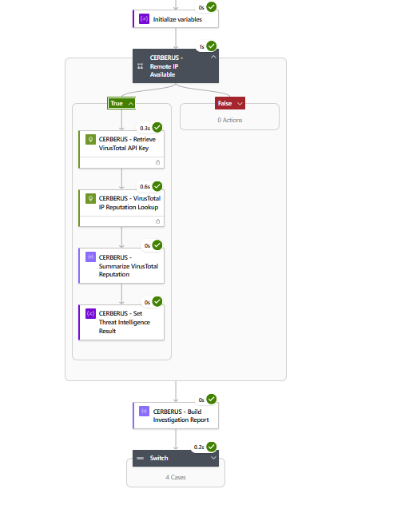
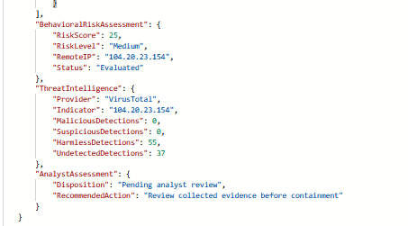
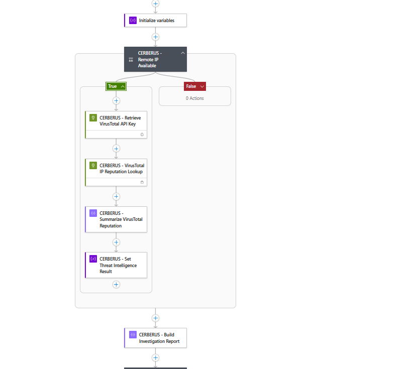

# CERBERUS — Validation & Test Results

## 1. Validation Overview

CERBERUS underwent controlled testing to evaluate its detection-to-investigation workflow across Microsoft Defender XDR, Microsoft Sentinel, Azure Logic Apps, Kusto Query Language (KQL), Azure Key Vault, and the VirusTotal API.

The primary end-to-end validation was completed on November 4, 2026.

The test used benign encoded PowerShell activity to generate observable endpoint telemetry, evaluate a custom Defender XDR detection, and provide incident context for automated investigation.

The resulting CERBERUS Logic App execution successfully performed behavioral risk assessment, conditional threat intelligence enrichment, and structured investigation report generation.

### Validation Objectives

The validation process was designed to:

- Confirm visibility of controlled endpoint process and network activity.
- Validate the custom Defender XDR detection against the simulated behavior.
- Examine alert generation and incident correlation.
- Evaluate Microsoft Sentinel automation behavior.
- Verify Logic App incident payload processing.
- Confirm endpoint investigation and behavioral risk scoring.
- Validate conditional Azure Key Vault and VirusTotal enrichment.
- Verify generation of a structured investigation report.
- Document observed results and remaining validation gaps.

### Validation Scope

The primary validation demonstrates one successful controlled investigation path.

It does not establish comprehensive reliability across every detection condition, incident lifecycle event, enrichment failure scenario, or severity-routing branch.

The simulation was benign and did not involve actual malware execution or unauthorized activity.

## 2. Test Environment & Configuration

### Environment Overview

CERBERUS was validated within a controlled Microsoft security lab using a Defender-onboarded Windows 11 endpoint.

The investigation workflow combined endpoint telemetry, Microsoft Sentinel incident context, and Azure Logic Apps orchestration.

### Technology Stack

| Component | Validation Role |
|---|---|
| Windows 11 endpoint | Generated controlled endpoint activity |
| Microsoft Defender for Endpoint | Collected process and network telemetry |
| Microsoft Defender XDR | Executed custom detection and correlated alerts |
| Microsoft Sentinel | Provided incident context and automation-rule evaluation |
| Azure Logic Apps | Orchestrated automated investigation |
| KQL / Advanced Hunting | Retrieved and correlated endpoint telemetry |
| Azure Key Vault | Stored the VirusTotal API credential |
| VirusTotal API | Provided external IP reputation statistics |
| JSON | Structured the final investigation report |

### Test Endpoint

| Configuration | Validated Value |
|---|---|
| Endpoint name | `nyc-cl11` |
| Operating system | Windows 11 |
| Defender onboarding | Enabled |
| Simulation type | Benign encoded PowerShell |
| Test destination | `example.com` |
| Observed remote IP | `104.20.23.154` |
| Observed remote port | `443` |

### Detection Configuration

The final validation used the following Microsoft Defender XDR custom detection:

`CERBERUS-FINAL-TEST - Encoded PowerShell Network Activity`

| Configuration | Value |
|---|---|
| Detection source | `DeviceNetworkEvents` |
| Detection frequency | Every hour |
| Lookback window | One hour |
| Alert severity | Medium |
| MITRE ATT&CK technique | `T1059` — Command and Scripting Interpreter |
| Device scope | NYC Client Machines |
| Incident correlation | Enabled |

The custom detection was intentionally restricted to the designated endpoint, encoded PowerShell command-line activity, and the benign test destination.

These restrictions supported reproducible testing rather than broad production detection coverage.

### Logic App Configuration

The primary investigation playbook was:

`la-cerberus-soc-triage`

The workflow included:

1. Microsoft Sentinel incident trigger and payload processing.
2. Defender device identification.
3. Automated process and network investigation.
4. Process-to-network correlation using KQL.
5. Rule-based behavioral risk scoring.
6. Conditional VirusTotal enrichment through Azure Key Vault.
7. Structured JSON investigation report generation.
8. Configured severity-based routing.

The successful final validation demonstrated the investigation, risk assessment, enrichment, and reporting path.

It did not independently establish successful execution of every configured severity-routing case.

### Validation Date

The primary end-to-end validation occurred on **November 4, 2026**.

The successful CERBERUS Logic App run began at approximately **4:03:06 PM** and completed in **7.92 seconds**.


## 3. Controlled Simulation & Detection Validation

### Simulation Overview

On November 4, 2026, a controlled, benign PowerShell simulation was executed on the Defender-onboarded Windows 11 endpoint `nyc-cl11`.

The objective was to generate recognizable encoded PowerShell execution and outbound network telemetry without introducing actual malware.

The simulation used PowerShell's `-EncodedCommand` parameter to execute a benign HTTPS request to `example.com`.

### Simulation Commands

The following commands were executed within the authorized lab environment:

```powershell
$script = 'Invoke-WebRequest -Uri "https://example.com" -UseBasicParsing | Out-Null'
$encoded = [Convert]::ToBase64String([Text.Encoding]::Unicode.GetBytes($script))
powershell.exe -NoProfile -EncodedCommand $encoded
```

The script converts the benign PowerShell command to UTF-16LE Base64 before executing it.

This produces a recognizable encoded-command indicator while generating process and network activity for Microsoft Defender for Endpoint to observe.

### Expected Detection Behavior

The custom detection was designed to identify network activity satisfying all of the following conditions:

1. The event occurred within the preceding one-hour lookback window.
2. The endpoint name matched `nyc-cl11`.
3. The initiating process was `powershell.exe`.
4. The initiating process command line contained `-EncodedCommand`.
5. The remote URL matched `example.com`.
6. The network action was `ConnectionSuccess`.

### Custom Detection KQL

The following query was used for the final controlled validation:

```kql
DeviceNetworkEvents
| where Timestamp > ago(1h)
| where DeviceName =~ "nyc-cl11"
| where InitiatingProcessFileName =~ "powershell.exe"
| where InitiatingProcessCommandLine contains "-EncodedCommand"
| where RemoteUrl =~ "example.com"
| where ActionType == "ConnectionSuccess"
| project
    Timestamp,
    DeviceId,
    DeviceName,
    ReportId,
    RemoteIP,
    RemoteUrl,
    RemotePort,
    InitiatingProcessId,
    InitiatingProcessCommandLine
```

The query was intentionally scoped to the controlled endpoint and benign destination.

It was designed to validate telemetry visibility and alert generation rather than provide comprehensive detection of malicious PowerShell activity.

### Observed Endpoint Telemetry

Microsoft Defender XDR recorded the following network event:

| Field | Observed Value |
|---|---|
| Endpoint | `nyc-cl11` |
| Initiating process | `powershell.exe` |
| Process ID | `9048` |
| Remote URL | `example.com` |
| Remote IP | `104.20.23.154` |
| Remote port | `443` |
| Network action | `ConnectionSuccess` |
| Event timestamp | November 4, 2026, 3:52:18 PM (lab local time) |

The initiating process command line contained the expected `-EncodedCommand` argument.

The observed network activity satisfied the configured custom detection conditions.

### Detection Outcome

Microsoft Defender XDR generated a Medium-severity alert named:

`CERBERUS-FINAL-TEST - Encoded PowerShell Network Activity`

Rather than creating a new incident, Defender XDR correlated the alert into existing incident `2471`.

The incident retained the title:

`Execution incident on one endpoint`

This distinction was significant because the original Microsoft Sentinel automation rule expected a newly created incident whose title contained the custom detection name.

### Validation Results

| Test Objective | Observed Result | Status |
|---|---|---|
| Execute benign encoded PowerShell | Simulation executed | Passed |
| Record endpoint network telemetry | Matching network event observed | Passed |
| Identify encoded PowerShell command line | `-EncodedCommand` observed | Passed |
| Match the benign destination | `example.com` observed | Passed |
| Generate custom Defender XDR alert | Expected alert generated | Passed |
| Associate alert with an incident | Existing incident `2471` updated | Passed |
| Create a new incident | Existing incident reused instead | Not observed |

### Detection Interpretation

The simulation successfully demonstrated endpoint telemetry collection, custom detection matching, alert generation, and incident correlation.

The observed behavior was intentionally benign.

The generated alert confirms that the configured detection conditions were satisfied; it does not independently establish malicious execution, exploitation, persistence, or compromise.

The successful detection provided the incident context used for subsequent CERBERUS investigation and automation validation.


## 4. Microsoft Sentinel Automation & Incident Processing Validation

### Validation Overview

The next validation stage examined how Microsoft Defender XDR alert correlation interacted with Microsoft Sentinel automation and the CERBERUS Logic App.

The objective was to determine whether the expected incident context could be processed by the investigation workflow.

### Incident Correlation Results

The custom Defender XDR detection generated an alert named:

`CERBERUS-FINAL-TEST - Encoded PowerShell Network Activity`

The alert was associated with existing incident `2471`.

| Field | Observed Value |
|---|---|
| Incident ID | `2471` |
| Incident title | `Execution incident on one endpoint` |
| Custom alert | `CERBERUS-FINAL-TEST - Encoded PowerShell Network Activity` |
| Alert severity | Medium |
| Incident behavior | Existing incident updated |
| New incident created | No |

The incident retained its existing generic title rather than adopting the custom detection name.

### Incident Creation Automation Rule

The original Microsoft Sentinel automation rule was configured as follows:

| Configuration | Value |
|---|---|
| Rule name | `CERBERUS - Controlled Incident Triage` |
| Rule order | `3` |
| Trigger | When an incident is created |
| Condition | Incident title contains `CERBERUS-FINAL-TEST` |
| Action | Run `la-cerberus-soc-triage` |

The observed incident-update scenario did not satisfy this rule's incident-creation trigger and title condition.

### Incident Update Automation Rule

A second automation rule was configured to address the observed incident correlation behavior.

| Configuration | Value |
|---|---|
| Rule name | `CERBERUS - Controlled Incident Update Validation` |
| Rule order | `5` |
| Trigger | When an incident is updated |
| Update condition | Alerts added |
| Incident title condition | Contains `Execution incident on one endpoint` |
| Alert title condition | Contains `CERBERUS-FINAL-TEST` |
| Action | Run `la-cerberus-soc-triage` |
| Configured expiration | November 5, 2026, 11:59 PM |

The update rule was designed to identify the relevant alert even when Defender XDR retained a generic incident title.

### Logic App Incident Processing

During the November 4, 2026 final validation, CERBERUS recorded a successful Logic App execution.

The workflow processed the expected incident and custom alert context.

| Field | Observed Value |
|---|---|
| Logic App | `la-cerberus-soc-triage` |
| Incident ID | `2471` |
| Alert title | `CERBERUS-FINAL-TEST - Encoded PowerShell Network Activity` |
| Execution start | Approximately 4:03:06 PM |
| Execution duration | 7.92 seconds |
| Run status | Succeeded |

The trigger payload contained the expected incident identifier and custom alert information.

These observations confirm successful incident-context processing by the CERBERUS Logic App.

However, the available execution evidence does not independently identify which Microsoft Sentinel automation rule initiated the successful run.

### Validation Results

| Test Objective | Observed Result | Status |
|---|---|---|
| Generate Defender XDR alert | Expected custom alert generated | Passed |
| Associate alert with an incident | Alert correlated into incident `2471` | Passed |
| Match original incident-creation conditions | Conditions did not match observed scenario | Not matched |
| Configure incident-update automation | Update rule configured | Passed |
| Process expected incident context | Incident `2471` processed | Passed |
| Execute CERBERUS investigation workflow | Successful Logic App run recorded | Passed |
| Independently verify initiating automation rule | Insufficient rule-execution evidence | Not verified |

### Validation Interpretation

The final validation demonstrated that CERBERUS could successfully process incident context associated with the custom Defender XDR detection.

It also demonstrated the importance of distinguishing incident creation from incident updates.

The results support successful downstream investigation execution, but they do not establish that every configured Sentinel automation rule was exercised or independently verified.

### Engineering Lessons

The validation highlighted several important considerations:

- Defender XDR may correlate new alerts into existing incidents.
- Alert titles and incident titles can differ.
- Automation rules must account for the incident lifecycle events they are intended to handle.
- Alert-level conditions can identify relevant detections when incident titles are generic.
- Successful Logic App execution should not be treated as independent proof of which automation rule initiated the run.
- Temporary validation rules should be reviewed and disabled or removed when no longer needed.


## 5. Automated Investigation & Behavioral Risk Validation

### Validation Objective

This stage evaluated whether CERBERUS could retrieve endpoint telemetry, correlate process and network activity, calculate a behavioral risk score, and select the appropriate enrichment path.

### Investigation Workflow

Following incident context processing, CERBERUS executed its configured endpoint investigation actions.

The workflow included:

1. Identifying the Defender endpoint associated with the incident.
2. Retrieving relevant process execution telemetry.
3. Retrieving related network activity.
4. Correlating process and network records using KQL.
5. Evaluating configured behavioral indicators.
6. Calculating a normalized risk score.
7. Assigning a behavioral risk classification.

### Process-to-Network Correlation

The correlation query joined `DeviceNetworkEvents` with `DeviceProcessEvents` using:

- `DeviceId`
- `InitiatingProcessId` matched to `ProcessId`
- `InitiatingProcessCreationTime` matched to `ProcessCreationTime`

The query used `join kind=inner`, retaining records with matching process and network identifiers.

Results were ordered by descending risk score and network timestamp, with up to 50 results returned.

The workflow used the highest-ranked correlated result for its behavioral risk assessment rather than calculating an incident-wide aggregate score.

### Behavioral Scoring Validation

The controlled encoded PowerShell simulation produced the following assessment:

| Indicator | Score Contribution |
|---|---:|
| Encoded PowerShell command | +25 |
| Download-and-execute pattern | 0 |
| Unusual destination port | 0 |
| Routine Defender activity adjustment | 0 |
| **Final risk score** | **25** |

The encoded PowerShell indicator matched the configured `-EncodedCommand` pattern.

The observed destination port `443` did not satisfy the unusual-port condition.

The final normalized score was `25`, resulting in a Medium behavioral risk classification.

### Validated Risk Assessment Output

The final investigation report included:

```json
{
  "BehavioralRiskAssessment": {
    "RiskScore": 25,
    "RiskLevel": "Medium",
    "RemoteIP": "104.20.23.154",
    "Status": "Evaluated"
  }
}
```

### Expected Versus Observed Results

| Validation Objective | Expected Result | Observed Result | Status |
|---|---|---|---|
| Endpoint context extraction | Identify the relevant Defender device | Expected endpoint context processed | Passed |
| Process/network correlation | Return matching correlated telemetry | Correlated behavior supported final risk assessment | Passed |
| Encoded command scoring | Add 25 points | Risk score of 25 reported | Passed |
| Risk classification | Assign Medium for score 25 | Medium reported | Passed |
| Remote IP selection | Identify an IP for enrichment | `104.20.23.154` selected | Passed |
| Incident-wide aggregation | Not implemented | Highest-ranked result used | Design limitation |

### Validation Interpretation

The successful execution demonstrates that CERBERUS processed the selected endpoint behavior and generated the expected behavioral risk assessment for the controlled test.

The scoring model is deterministic and based on configured indicators. A Medium risk classification does not independently establish malicious activity.

The validation supports successful execution of the observed investigation path, not comprehensive accuracy across all endpoint behaviors or incident types.

### Related Documentation

Detailed correlation fields and scoring expressions are documented in [04 — Behavioral Risk Scoring & KQL](04-Risk-Scoring.md).

The investigation workflow and action sequence are documented in [03 — SOAR Automation & Logic Apps](03-SOAR-Automation.md).


## 6. Threat Intelligence & Investigation Report Validation

### Validation Objective

This stage evaluated whether CERBERUS could conditionally enrich a correlated network indicator using VirusTotal, securely retrieve the required API credential from Azure Key Vault, and incorporate the resulting intelligence into a structured investigation report.

### Enrichment Decision

CERBERUS used the following conditions to determine whether threat intelligence enrichment should execute:

- Behavioral risk score greater than or equal to `25`.
- A nonempty remote IP address available for investigation.

The final controlled test produced:

| Evaluation Field | Observed Value |
|---|---|
| Behavioral risk score | `25` |
| Risk classification | Medium |
| Remote IP | `104.20.23.154` |
| Enrichment threshold | `25` |
| Enrichment decision | Eligible |

The selected result satisfied the configured enrichment conditions.

### Azure Key Vault Validation

The workflow used Azure Key Vault to retrieve the credential required for the VirusTotal API request.

During the successful November 4 execution, the credential retrieval action completed successfully.

This validated the configured secret retrieval path for the observed test.

The API credential was not included in the final investigation report.

### VirusTotal Enrichment Results

CERBERUS queried VirusTotal for the selected remote IP address:

`104.20.23.154`

The resulting reputation statistics were:

| VirusTotal Classification | Detection Count |
|---|---:|
| Malicious | 0 |
| Suspicious | 0 |
| Harmless | 55 |
| Undetected | 37 |

The VirusTotal request and subsequent enrichment processing completed successfully during the observed execution.

These statistics reflect the returned reputation data at the time of the test.

Zero malicious detections do not establish that an indicator is safe or that the associated endpoint activity is benign.

### Structured Investigation Report

CERBERUS generated a structured JSON investigation report combining behavioral risk assessment, external threat intelligence, and analyst-oriented recommendations.

The validated report included the following fields:

```json
{
  "BehavioralRiskAssessment": {
    "RiskScore": 25,
    "RiskLevel": "Medium",
    "RemoteIP": "104.20.23.154",
    "Status": "Evaluated"
  },
  "ThreatIntelligence": {
    "Provider": "VirusTotal",
    "Indicator": "104.20.23.154",
    "MaliciousDetections": 0,
    "SuspiciousDetections": 0,
    "HarmlessDetections": 55,
    "UndetectedDetections": 37
  },
  "AnalystAssessment": {
    "Disposition": "Pending analyst review",
    "RecommendedAction": "Review collected evidence before containment"
  }
}
```

The report preserved a human-review disposition rather than asserting confirmed malicious activity or initiating automatic containment.

### Validation Results

| Validation Objective | Observed Result | Status |
|---|---|---|
| Evaluate enrichment conditions | Score `25` and remote IP satisfied conditions | Passed |
| Retrieve API credential | Azure Key Vault action succeeded | Passed |
| Request IP reputation | VirusTotal API action succeeded | Passed |
| Extract reputation statistics | Expected classification counts populated | Passed |
| Generate investigation report | Structured JSON report produced | Passed |
| Preserve analyst review | Report recommended review before containment | Passed |
| Handle VirusTotal API failures | Not independently tested | Not tested |
| Handle Key Vault retrieval failures | Not independently tested | Not tested |

### Validation Evidence

The following screenshots document the observed workflow execution and investigation output.

**Figure 29 — Successful CERBERUS End-to-End Automation Execution**



**Figure 30 — Final Enriched Investigation Report**



**Figure 34 — Conditional Threat Intelligence Workflow**



### Validation Interpretation

The successful execution demonstrated the configured conditional enrichment path for a Medium-risk correlated endpoint event.

CERBERUS retrieved the required credential, queried VirusTotal, processed the returned statistics, and incorporated the results into a structured investigation report.

The observed validation supports successful execution of this specific enrichment path.

It does not establish reliability during credential retrieval failures, API rate limiting, malformed responses, or other external service errors.

### Related Documentation

See [05 — Threat Intelligence](05-Threat-Intelligence.md) for integration design, credential handling, and enrichment limitations.

See [03 — SOAR Automation](03-SOAR-Automation.md) for the corresponding Logic App workflow.
